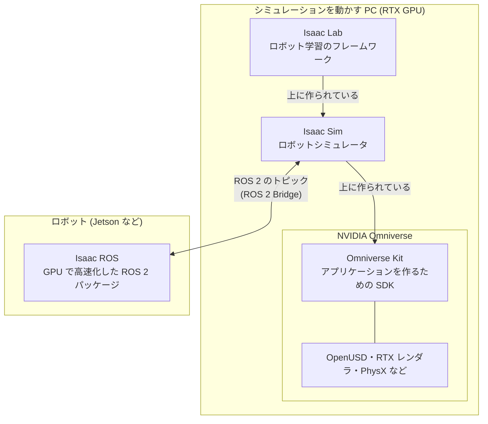

# 0. はじめに

!!! info "この章で学ぶこと"
    このチュートリアルの対象読者・前提知識・ゴールと全体の流れを確認し、Isaac Sim の全体像と、以降の章で使う用語をつかみます。

    - **所要時間**: 10 分
    - **前提**: なし
    - **対象バージョン**: Isaac Sim 6.1.0

## 対象読者と前提知識

このチュートリアルは、次のような方を対象にしています。

- Python でプログラムを書ける
- ロボティクスやロボットシミュレータを使うのは初めて

次の知識は前提とします。

| 項目 | 目安 |
| --- | --- |
| Python | 関数・クラス・`import` が分かり、スクリプトを実行できる |
| Linux | ターミナルでファイル操作やコマンド実行ができる |
| Docker | `docker run` や `docker compose up` でコンテナを起動・停止したことがある |

ROS 2 や強化学習の知識は必要ありません。

## このチュートリアルのゴール

最終的に、次のことができるようになるのがゴールです。

- Docker で Isaac Sim を起動し、ブラウザから画面を操作できる
- Python スクリプトからシーンを組み立て、シミュレーションを進められる
- 移動ロボット (Jetbot) を動かし、カメラや LiDAR のデータを取得できる

7 章では、これらを組み合わせて **LiDAR で障害物を避けながらゴールへ向かう Jetbot** を作ります。

## Isaac Sim とは

**Isaac Sim** は、NVIDIA が提供するロボットシミュレータです。主に次のような特徴があります。

- **物理シミュレーション**: NVIDIA PhysX による剛体・関節・車輪などの物理演算
- **写実的なレンダリング**: RTX GPU によるレイトレーシングで、カメラ画像や LiDAR をリアルに再現できる
- **USD ベースのシーン**: シーンやロボットを USD 形式で扱う (3 章で解説します)
- **Python API**: GUI 操作だけでなく、Python からすべてを制御できる

ロボットのアルゴリズムを実機で試す前に検証したり、機械学習用の合成データを作ったりする用途で使われています。

## Isaac Sim と関連するソフトウェア {#ecosystem}

Isaac Sim について調べると、**Omniverse**・**Isaac Lab**・**Isaac ROS** といった名前がよく一緒に出てきます。どれも NVIDIA のソフトウェアで名前が似ていますが、役割はそれぞれ違います。関係を図にすると次のようになります。



| ソフトウェア | 役割 | このチュートリアルでの扱い |
| --- | --- | --- |
| NVIDIA Omniverse | 3D アプリケーションを作るためのプラットフォーム。シーンの記述 (OpenUSD)、レンダリング (RTX)、物理演算 (PhysX) などの技術と、アプリケーションを作るための SDK (**Omniverse Kit**) からなる | Isaac Sim の土台として、USD (3 章) や拡張機能の仕組みに触れる |
| Isaac Sim | Omniverse の上に作られたロボットシミュレータ | 本編 (1〜7 章) で扱う |
| Isaac Lab | Isaac Sim の上に作られたロボット学習 (強化学習・模倣学習など) 用のフレームワーク | [付録 C](appendix/next-steps.md#isaac-lab) で紹介する |
| Isaac ROS | GPU で高速化した ROS 2 のパッケージ群。Jetson などで動かし、実機のロボットのソフトウェアに組み込む | 扱わない |

### Omniverse と Isaac Sim

Omniverse は、特定の用途のアプリケーションではなく、3D アプリケーションを作るための土台です。Isaac Sim はその上に作られたアプリケーションの 1 つで、Omniverse の技術をロボットのシミュレーション向けにまとめたものです。

Isaac Sim の機能は、Omniverse Kit の **拡張機能 (Extension)** として作られています。このチュートリアルで使う `isaacsim.core.experimental` 系の API や、3 章で出てくる `omni.usd.libs` も、拡張機能として提供されています。シーンを USD で表すのも、Omniverse の上に作られているからです。

### Isaac Lab と Isaac Sim

Isaac Lab は、Isaac Sim の上に作られたロボット学習用のフレームワークです。シミュレーションそのものは Isaac Sim が行い、Isaac Lab は多数の環境を並列に動かしたり、報酬を定義して方策を学習させたりする部分を受け持ちます。

Isaac Lab と組み合わせて使える Isaac Sim のバージョンは、Isaac Lab のバージョンごとに決まっています。このチュートリアルの Isaac Sim 6.1.0 に対応するバージョンは、[付録 C](appendix/next-steps.md#isaac-lab) を参照してください。

### Isaac ROS と Isaac Sim

Isaac ROS は、名前に「Isaac」が付いていますが、シミュレータではありません。実機のロボット (Jetson など) で動かす ROS 2 のパッケージ群で、画像認識や自己位置推定などの処理を GPU で高速化します。Isaac Sim をインストールしても Isaac ROS は入りませんし、Isaac ROS を使うのに Isaac Sim は必須ではありません。

!!! warning "Isaac ROS と ROS 2 Bridge を混同しない"
    Isaac Sim には、シミュレータのセンサデータを ROS 2 のトピックとして配信する **ROS 2 Bridge** があります ([付録 C](appendix/next-steps.md#ros2))。これは Isaac Sim の機能の 1 つで、Isaac ROS とは別物です。

両者は ROS 2 のトピックを通じて組み合わせられます。Isaac Sim のカメラ画像を ROS 2 Bridge で配信し、それを Isaac ROS のパッケージで処理すると、実機のロボットがなくても Isaac ROS の処理をシミュレーションで試せます。

## 検証環境

このチュートリアルの手順とサンプルコードは、次の環境で動作を確認しています。

| 項目 | 内容 |
| --- | --- |
| OS | Ubuntu 24.04.3 LTS |
| CPU | Intel Core i7-9800X (8 コア / 16 スレッド) |
| メモリ | 32GB |
| GPU | NVIDIA GeForce RTX 2080 Ti (VRAM 11GB) |
| NVIDIA ドライバ | 595.99.02 |
| Docker | 28.3.3 (Compose v2.39.1) |
| NVIDIA Container Toolkit | 1.17.8 |
| Isaac Sim | 6.1.0 (`nvcr.io/nvidia/isaac-sim:6.1.0`) |

!!! warning "検証環境は公式の推奨要件を満たしていません"
    Isaac Sim 6.1.0 の公式の最小要件は **RTX 4080 (VRAM 16GB)** です。検証環境の RTX 2080 Ti はこれを下回っているため、このチュートリアルの範囲では動作しても、より重いシーンでは動かない可能性があります。これから GPU を用意する場合は、[公式の要件](https://docs.isaacsim.omniverse.nvidia.com/6.1.0/installation/requirements.html) を満たすものを選んでください。

手元に NVIDIA GPU がない場合は、[付録 A. クラウドで動かす](appendix/cloud.md) を参照してください。

## 全体の流れ

| 章 | 内容 | 主に使うもの |
| --- | --- | --- |
| [1. 環境構築](01-setup.md) | Docker で Isaac Sim を起動し、ブラウザから接続する | Docker |
| [2. GUI の基本](02-gui-basics.md) | 物体を置き、物理シミュレーションを動かす | GUI |
| [3. USD の基礎](03-usd-basics.md) | シーンを表す USD の基本概念 | Python (USD) |
| [4. Python スタンドアロン入門](04-python-standalone.md) | Python スクリプトからシーンを作り、シミュレーションを進める | Python |
| [5. ロボットを動かす](05-robot-control.md) | Jetbot を差動二輪の制御で走らせる | Python |
| [6. センサ](06-sensors.md) | カメラと LiDAR を取り付け、データを取得する | Python |
| [7. ミニプロジェクト](07-mini-project.md) | LiDAR で障害物を避けながらゴールへ向かう | Python |

前の章の内容を前提に進むので、順番に読むことをおすすめします。

## このチュートリアルの読み方

### サンプルコード

サンプルコードは GitHub リポジトリの `examples/` にあります。最初にリポジトリを取得しておいてください。

```bash
git clone https://github.com/atinfinity/isaac-sim-tutorial.git
cd isaac-sim-tutorial
```

### 表記

- GUI のメニューは英語表記のまま `Create > Mesh > Cube` のように書きます
- 補足は次のような囲みで示します

!!! tip "ヒント"
    知っておくと便利なことです。

!!! warning "注意"
    つまずきやすい点や、注意が必要なことです。

## 用語集

以降の章で使う主な用語です。分からない用語が出てきたら、ここに戻って確認してください。

### Isaac Sim と実行環境

| 用語 | 意味 |
| --- | --- |
| Isaac Sim | NVIDIA のロボットシミュレータ |
| Omniverse | NVIDIA の 3D アプリケーションのプラットフォーム。Isaac Sim はこの上に作られている ([関連するソフトウェア](#ecosystem)) |
| Omniverse Kit | Omniverse のアプリケーションを作るための SDK。Isaac Sim の機能は Kit の **拡張機能 (Extension)** として提供されている |
| Isaac Lab | Isaac Sim の上に作られたロボット学習用のフレームワーク (付録 C) |
| Isaac ROS | GPU で高速化した ROS 2 のパッケージ群。Isaac Sim とは別のソフトウェア ([関連するソフトウェア](#ecosystem)) |
| NGC | NVIDIA GPU Cloud。Isaac Sim の Docker イメージ (`nvcr.io/nvidia/isaac-sim`) はここで配布されている |
| NVIDIA Container Toolkit | Docker コンテナから GPU を使えるようにするツール |
| ヘッドレス (headless) | 画面 (ウィンドウ) を表示せずに実行すること |
| ライブストリーミング | Isaac Sim をヘッドレスで動かし、画面を WebRTC で別のアプリやブラウザに送って表示する仕組み |
| Web ビューア | ライブストリーミングの画面をブラウザで表示するアプリ。このチュートリアルではポート `8210` で使う |

### シーンと USD

| 用語 | 意味 |
| --- | --- |
| USD | Universal Scene Description。Pixar が開発した 3D シーンの記述形式 (3 章) |
| Stage | 1 つのシーン全体 (3 章) |
| Prim | Stage に置かれる要素。`/World/Cube` のようなパスで表す (3 章) |
| Attribute | Prim が持つ値 (大きさ、色、位置など) (3 章) |
| Xform | 子の Prim をまとめ、位置・回転・スケールを与える Prim (3 章) |
| ワールド座標系 | シーン全体の基準となる座標系。Isaac Sim では右手系で X 前・Y 左・Z 上 (3 章) |
| ローカル座標 | 親の Prim から見た位置や向き (3 章) |
| metersPerUnit | USD の Stage で 1 単位が何メートルかを表す値。Isaac Sim の標準は 1.0 (3 章) |
| 四元数 (クォータニオン) | 4 つの数で回転を表す方法。Isaac Sim の API では `(w, x, y, z)` の順 (3 章) |
| Reference | 別の USD ファイルを Prim として取り込む仕組み。アセットの読み込みに使う (3 章) |
| アセット | ロボットや環境などの、再利用できる USD ファイル |

### シミュレーション

| 用語 | 意味 |
| --- | --- |
| 物理シミュレーション | 重力・衝突・関節などの物理法則を計算して、物体の動きを再現すること |
| PhysX | Isaac Sim が使っている NVIDIA の物理エンジン |
| ステップ (step) | シミュレーションの時間を 1 刻み進めること。1 ステップの時間幅を **dt** と呼ぶ |
| タイムライン | シミュレーションの再生・一時停止・停止を管理するもの。GUI の ▶ ボタンに対応する |
| コリジョン (collision) | 物体どうしの衝突判定。設定しないと物体がすり抜ける |
| スタンドアロンスクリプト | Python から Isaac Sim を起動し、シミュレーションを制御するスクリプト (4 章) |

### ロボットとセンサ

| 用語 | 意味 |
| --- | --- |
| Jetbot | NVIDIA の小型の教育用移動ロボット。このチュートリアルの題材 |
| Articulation | 関節でつながったリンクの集まり。Isaac Sim ではロボットを Articulation として扱う (5 章) |
| 関節 (joint) | リンクどうしをつなぎ、回転や直動を可能にする部分 |
| 差動二輪 (differential drive) | 左右 2 つの車輪の速度差で進行方向を変える駆動方式。Jetbot はこの方式 (5 章) |
| LiDAR | レーザーで周囲の物体までの距離を測るセンサ (6 章) |
| RGB 画像 / Depth 画像 | カメラから得られる色の画像 / 各画素までの距離を表す画像 (6 章) |

## 参考リンク

- [Isaac Sim 6.1.0 ドキュメント](https://docs.isaacsim.omniverse.nvidia.com/6.1.0/index.html)
- [Isaac Sim の動作要件](https://docs.isaacsim.omniverse.nvidia.com/6.1.0/installation/requirements.html)
- [Isaac Sim (GitHub)](https://github.com/isaac-sim/IsaacSim)
- [Omniverse Kit の概要 (Kit Manual)](https://docs.omniverse.nvidia.com/kit/docs/kit-manual/latest/guide/kit_overview.html)
- [Isaac Lab ドキュメント](https://isaac-sim.github.io/IsaacLab/main/index.html)
- [Isaac ROS ドキュメント](https://nvidia-isaac-ros.github.io/index.html)
- [NVIDIA Isaac ROS (Isaac Sim ドキュメント)](https://docs.isaacsim.omniverse.nvidia.com/6.1.0/nvidia_isaac_ros/isaac_ros_tutorials.html)
