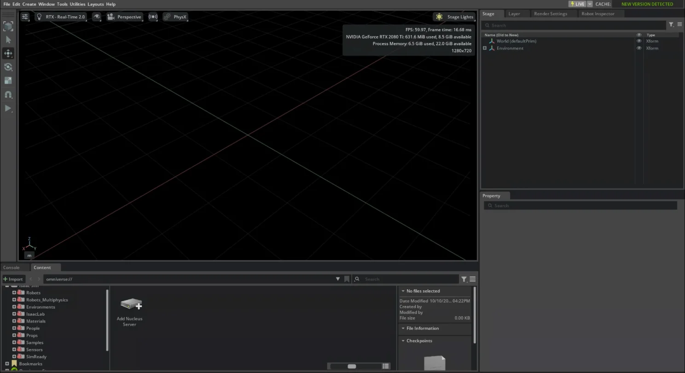

# 1. 環境構築

!!! info "この章で学ぶこと"
    Docker で Isaac Sim 6.1.0 を起動し、ブラウザから画面を表示する

    - **所要時間**: 60 分 (ダウンロード時間を除く)
    - **前提**: 0 章
    - **対象バージョン**: Isaac Sim 6.1.0

## ホストの要件 {#host-requirements}

Isaac Sim 6.1.0 の公式の要件 ([Isaac Sim Requirements](https://docs.isaacsim.omniverse.nvidia.com/6.1.0/installation/requirements.html)) のうち、最小構成と、このチュートリアルの検証環境を並べると次のようになります。

| 項目 | 公式の最小要件 | 検証環境 |
| --- | --- | --- |
| OS | Ubuntu 22.04 / 24.04 | Ubuntu 24.04.3 LTS |
| CPU | Intel Core i7 (第 7 世代) / AMD Ryzen 5 以上、4 コア | Intel Core i7-9800X (8 コア / 16 スレッド) |
| メモリ | 32GB | 32GB |
| ストレージ | 50GB (SSD) | 50GB 以上の空き |
| GPU | GeForce RTX 4080 | GeForce RTX 2080 Ti |
| VRAM | 16GB | 11GB |

Isaac Sim のコンテナは Linux でのみサポートされています。このチュートリアルでも Linux (Ubuntu) を前提にします。

!!! warning "検証環境の GPU は公式の最小要件を下回っています"
    検証環境の RTX 2080 Ti (VRAM 11GB) は、公式の最小要件 (RTX 4080 / VRAM 16GB) を満たしていません。このチュートリアルの範囲 (Jetbot 1 台程度のシーン) では動作を確認していますが、より重いシーンでは動かない可能性があります。

あとで実行する互換性チェック (`isaac-sim.compatibility_check.sh`) は、公式の要件とは別の基準で判定します。検証環境では次のように表示され、全体の判定は `PASSED` でした。

| 項目 | 判定 | 互換性チェックの最低要件 |
| --- | --- | --- |
| NVIDIA ドライバ | `supported` | 535.161 |
| GPU 0: VRAM | `enough (more is recommended)` | 10GB |
| CPU のコア数 | `excellent` | 4 |
| RAM | `enough (more is recommended)` | 32GB |
| ストレージ | `excellent` | 50GB |

`enough (more is recommended)` は「最低要件は満たすが、推奨には届かない」という意味です。

## NVIDIA ドライバ {#nvidia-driver}

ホストに NVIDIA ドライバが入っているかを `nvidia-smi` で確認します。

```bash
nvidia-smi
```

GPU の名前と `Driver Version` が表示されれば、ドライバは入っています。バージョンの目安は次のとおりです。

| 基準 | Linux のドライバのバージョン |
| --- | --- |
| 公式の検証済みバージョン ([Isaac Sim Requirements](https://docs.isaacsim.omniverse.nvidia.com/6.1.0/installation/requirements.html)) | 595.58.03 |
| 互換性チェックの最低要件 | 535.161 |
| このチュートリアルの検証環境 | 595.99.02 |

ドライバが入っていない場合や、バージョンが古い場合は、Ubuntu のパッケージや NVIDIA の公式サイトのインストーラで更新してください。

!!! warning "ドライバを更新したら PC を再起動する"
    ドライバを更新したあと再起動しないと、ドライバのライブラリと動いているカーネルモジュールのバージョンが食い違います。この状態では `nvidia-smi` が `Driver/library version mismatch` で失敗し、Isaac Sim のコンテナも起動しません。詳しくは [付録 B の「`driver/library version mismatch` でコンテナが起動しない」](appendix/troubleshooting.md#driver-mismatch) を参照してください。

## Docker と NVIDIA Container Toolkit {#docker}

Isaac Sim はコンテナで動かします。コンテナから GPU を使うには、Docker に加えて **NVIDIA Container Toolkit** が必要です。検証環境のバージョンは次のとおりです。

| ソフトウェア | 検証環境のバージョン |
| --- | --- |
| Docker Engine | 28.3.3 |
| Docker Compose (プラグイン) | v2.39.1 |
| NVIDIA Container Toolkit | 1.17.8 |

まだ入っていない場合は、公式の手順でインストールしてください。

- Docker Engine: [Install Docker Engine on Ubuntu](https://docs.docker.com/engine/install/ubuntu/)。`sudo` なしで `docker` を使えるように、[Linux post-installation steps](https://docs.docker.com/engine/install/linux-postinstall/) の `docker` グループの設定もしておきます
- NVIDIA Container Toolkit: [Installing the NVIDIA Container Toolkit](https://docs.nvidia.com/datacenter/cloud-native/container-toolkit/latest/install-guide.html)。インストール後に、同じページの「Configuring Docker」(`nvidia-ctk runtime configure --runtime=docker` と Docker の再起動) まで行います

インストールできたら、バージョンを確認します。

```bash
docker --version
docker compose version
nvidia-ctk --version
```

このチュートリアルの `docker/compose.yml` は `runtime: nvidia` を指定しているので、Docker に `nvidia` ランタイムが登録されている必要があります。`docker info` の `Runtimes` に `nvidia` が含まれていることを確認します。

```bash
docker info | grep -i runtimes
```

```text
 Runtimes: runc io.containerd.runc.v2 nvidia
```

最後に、コンテナから GPU が見えるかを確かめます。

```bash
docker run --rm --runtime=nvidia --gpus all ubuntu nvidia-smi -L
```

```text
GPU 0: NVIDIA GeForce RTX 2080 Ti (UUID: GPU-...)
```

ホストで `nvidia-smi` を実行したときと同じ GPU が表示されれば準備完了です。エラーになる場合は [付録 B の「その他の理由でコンテナが起動しない」](appendix/troubleshooting.md#container-not-starting) を参照してください。

## リポジトリの取得とキャッシュ用ディレクトリ {#clone-and-cache}

このチュートリアルのリポジトリを取得します。Docker の構成 (`docker/compose.yml`) とサンプルコード (`examples/`) が入っています。

```bash
git clone https://github.com/atinfinity/isaac-sim-tutorial.git
cd isaac-sim-tutorial
```

以降のコマンドは、すべてこのリポジトリのルートで実行します。

次に、Isaac Sim のキャッシュ・設定・ログを置くディレクトリをホストに作ります。コンテナを消してもキャッシュが残るので、2 回目以降の起動が速くなります。

```bash
mkdir -p ~/docker/isaac-sim/{cache/main,cache/computecache,cache/kit,config,data,logs,pkg}
mkdir -p ~/.cache/ov/hub
sudo chown -R 1234:1234 ~/docker/isaac-sim ~/.cache/ov/hub
```

コンテナ内の Isaac Sim は uid 1234 のユーザーで動くため、`chown` でディレクトリの所有者を uid 1234 にしています。これを忘れると書き込みに失敗します ([付録 B の「キャッシュ用ディレクトリの権限エラー」](appendix/troubleshooting.md#permission-denied))。

各ディレクトリは、コンテナ内の次の場所にマウントされます。

| ホスト | コンテナ | 中身 |
| --- | --- | --- |
| `~/docker/isaac-sim/cache/main` | `/isaac-sim/.cache` | キャッシュ全般 |
| `~/docker/isaac-sim/cache/computecache` | `/isaac-sim/.nv/ComputeCache` | GPU 向けにコンパイルしたコード |
| `~/docker/isaac-sim/cache/kit` | `/isaac-sim/kit/cache` | Kit (Isaac Sim の土台) のキャッシュ |
| `~/docker/isaac-sim/config` | `/isaac-sim/.nvidia-omniverse/config` | 設定 |
| `~/docker/isaac-sim/data` | `/isaac-sim/.local/share/ov/data` | データ |
| `~/docker/isaac-sim/logs` | `/isaac-sim/.nvidia-omniverse/logs` | ログ |
| `~/docker/isaac-sim/pkg` | `/isaac-sim/.local/share/ov/pkg` | パッケージ |
| `~/.cache/ov/hub` | `/var/cache/hub` | アセットのダウンロードキャッシュ |
| リポジトリの `examples/` | `/workspace/examples` (読み取り専用) | サンプルコード |

!!! tip "設定を変えたいとき"
    置き場所やポート番号を変えたい場合は、`docker/.env.example` を `docker/.env` にコピーして編集します。既定のままでよければ、`.env` は作らなくてかまいません。

    ```bash
    cp docker/.env.example docker/.env
    ```

    `.env` では `~` が展開されないため、パスは絶対パスで書いてください。

## Isaac Sim の起動 {#launch}

### イメージの取得 {#pull}

Isaac Sim 6.1.0 のイメージを NGC (NVIDIA のコンテナレジストリ) から取得します。NGC へのログイン (`docker login nvcr.io`) は必要ありません。

```bash
docker pull nvcr.io/nvidia/isaac-sim:6.1.0
```

イメージは約 21GB あり、検証環境では取得に約 17 分かかりました。

### 互換性チェック {#compatibility-check}

起動する前に、Isaac Sim に同梱の互換性チェックで、このマシンで動くかを確かめます。

```bash
docker compose -f docker/compose.yml run --rm --no-deps --entrypoint bash isaac-sim \
  -c "./isaac-sim.compatibility_check.sh --/app/quitAfter=10 --no-window"
```

最後に `System checking result: PASSED` と表示されれば問題ありません。検証環境での判定は「[ホストの要件](#host-requirements)」の表のとおりです。途中で出る警告の読み方は [付録 B の「互換性チェックの結果の読み方」](appendix/troubleshooting.md#compatibility-check) を参照してください。

### 起動 {#compose-up}

Isaac Sim と Web ビューアを起動します。

```bash
docker compose -f docker/compose.yml up -d
```

`docker/compose.yml` には 2 つのサービスが定義されています。

| サービス | 役割 |
| --- | --- |
| `isaac-sim` | Isaac Sim 本体。画面を持たない (ヘッドレス) モードで動き、映像を WebRTC で配信する |
| `web-viewer` | 配信された映像をブラウザで表示する Web アプリ (ポート 8210)。初回の起動時に、公式リポジトリからビルドされる |

`web-viewer` は `isaac-sim` の起動が終わるのを待ってから起動します。状態は `docker compose ps` で確認できます。

```bash
docker compose -f docker/compose.yml ps
```

`STATUS` が両方とも `(healthy)` になれば起動完了です。

```text
NAME                  IMAGE                            COMMAND                   SERVICE      CREATED              STATUS                        PORTS
docker-isaac-sim-1    nvcr.io/nvidia/isaac-sim:6.1.0   "/isaac-sim/runheadl…"   isaac-sim    About a minute ago   Up About a minute (healthy)
docker-web-viewer-1   docker-web-viewer                "npx vite preview --…"   web-viewer   About a minute ago   Up 15 seconds (healthy)
```

検証環境では、初回は約 4.5 分 (Web ビューアのビルドを含む)、2 回目以降は 1〜1.5 分ほどで両方 `(healthy)` になりました。初回はシェーダーのコンパイルなどで時間がかかります ([付録 B の「起動が遅い」](appendix/troubleshooting.md#slow-startup))。

!!! tip "ログを見る"
    起動の途中経過は `docker compose -f docker/compose.yml logs -f isaac-sim` で見られます。`Ctrl+C` でログの表示だけを止められます (コンテナは止まりません)。

## Web ビューアで接続する {#web-viewer}

両方のサービスが `(healthy)` になったら、Chrome や Edge などの Chromium 系のブラウザで次の URL を開きます。

```text
http://localhost:8210
```

次のような Isaac Sim の画面が表示されれば成功です。画面の各部分の名前と操作は 2 章で説明します。



!!! warning "メニューバーが見えないときは全画面表示にする"
    ブラウザのウィンドウが小さいと、画面の上端のメニューバー (`File`・`Edit`・`Create` など) が切れて見えないことがあります。ブラウザを全画面表示 (++f11++) にしてください ([付録 B](appendix/troubleshooting.md#menu-hidden))。

!!! tip "Web ビューアの操作の注意"
    - キー入力は、テキスト欄にフォーカスが当たっていなくても Isaac Sim に送られ、ショートカットとして解釈されます (たとえば ++e++ で Rotate ツールに切り替わります)
    - テキスト欄では、速く入力したキーや連続して押した ++backspace++ が取りこぼされることがあります。ファイルダイアログでは、パスを入力するより左のツリーをたどるほうが確実です

何も映らない場合は [付録 B の「Web ビューアに何も映らない」](appendix/troubleshooting.md#blank-viewer) を、別の PC のブラウザから接続したい場合は [付録 B の「別の PC のブラウザから接続できない」](appendix/troubleshooting.md#remote-access) を参照してください。

## 停止と再起動 {#stop-and-restart}

使い終わったら、コンテナを停止して削除します。

```bash
docker compose -f docker/compose.yml down
```

コンテナは削除されますが、キャッシュ・設定・ログはホストの `~/docker/isaac-sim` に残ります。もう一度使うときは、同じコマンドで起動します。

```bash
docker compose -f docker/compose.yml up -d
```

キャッシュが残っているので、2 回目以降は初回より速く起動します。

!!! warning "起動したままにすると PC の起動時にも立ち上がる"
    `docker/compose.yml` は `restart: unless-stopped` を指定しています。`down` せずに PC を再起動すると、Docker の起動とともに Isaac Sim も起動し、GPU のメモリを使い続けます。使わないときは `down` しておきましょう。

!!! note "スクリプトの実行には `up` は不要"
    4 章以降で Python スクリプトを実行するときは、`docker compose run` で使い捨てのコンテナを作ります。`up -d` で起動した Isaac Sim とは別のコンテナなので、GUI を使わないときは `down` してから実行すると GPU のメモリを節約できます。

## まとめ {#summary}

- Isaac Sim 6.1.0 は、Docker と NVIDIA Container Toolkit を使ってコンテナで動かす
- キャッシュ用ディレクトリは uid 1234 の所有にしておく。キャッシュが残るので 2 回目以降の起動が速くなる
- `docker compose -f docker/compose.yml up -d` で起動し、`ps` で両方 `(healthy)` になるのを待つ
- 画面は Chromium 系のブラウザで `http://localhost:8210` を開いて見る。メニューが切れるときは全画面表示にする
- 使い終わったら `docker compose -f docker/compose.yml down` で停止する

## 演習 {#exercises}

1. Isaac Sim を起動している間に、ホストで `nvidia-smi` を実行して、GPU のメモリをどれくらい使っているかを確認してみましょう。`down` したあとと比べてみてください
2. `down` してからもう一度 `up -d` し、`(healthy)` になるまでの時間を初回と比べてみましょう
3. `~/docker/isaac-sim/logs/Kit/` の下に Isaac Sim のログ (`kit_*.log`) ができていることを確認してみましょう。起動のたびにファイルが 1 つ増えます。互換性チェックのログは別のディレクトリにできます

## 参考リンク {#references}

- [Isaac Sim Requirements (Isaac Sim ドキュメント)](https://docs.isaacsim.omniverse.nvidia.com/6.1.0/installation/requirements.html)
- [Container Installation (Isaac Sim ドキュメント)](https://docs.isaacsim.omniverse.nvidia.com/6.1.0/installation/install_container.html)
- [Isaac Sim (NGC Catalog)](https://catalog.ngc.nvidia.com/orgs/nvidia/containers/isaac-sim)
- [Installing the NVIDIA Container Toolkit](https://docs.nvidia.com/datacenter/cloud-native/container-toolkit/latest/install-guide.html)
- [Install Docker Engine on Ubuntu](https://docs.docker.com/engine/install/ubuntu/)
- [Linux post-installation steps for Docker Engine](https://docs.docker.com/engine/install/linux-postinstall/)
