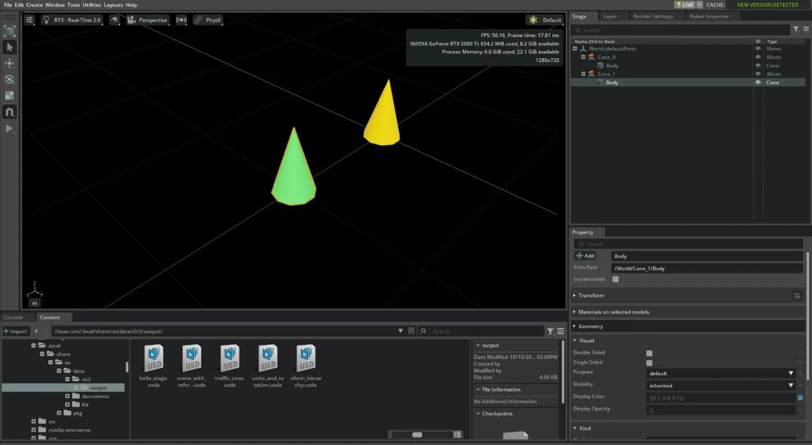

# 3. USD の基礎

!!! info "この章で学ぶこと"
    Isaac Sim のシーンを表現している USD の基本概念 (Stage・Prim・Attribute・Xform・Reference) と、Isaac Sim の座標系・単位の約束ごとを、Python で実際にファイルを作りながら理解します。

    - **所要時間**: 45 分
    - **前提**: 2 章
    - **対象バージョン**: Isaac Sim 6.1.0

## USD とは

**USD (Universal Scene Description)** は、Pixar が開発した 3D シーンの記述形式です。Isaac Sim で扱うシーンやロボット、環境は、すべて USD で表現されています。2 章で GUI から保存したファイルも USD です。

USD を理解しておくと、次のことが分かるようになります。

- GUI の **Stage** パネルに並んでいるツリーが何を表しているのか
- Python から物体の位置や色を変えるとき、何を操作しているのか
- ロボットのアセットをシーンに「読み込む」とは、何をしているのか

USD のファイルには主に次の拡張子があります。

| 拡張子 | 形式 | 用途 |
| --- | --- | --- |
| `.usda` | テキスト | 人が読める。学習やデバッグ向き |
| `.usdc` | バイナリ | 読み込みが速く、サイズが小さい |
| `.usd` | どちらでもよい | 中身はテキストかバイナリのどちらか |

この章では、中身を読めるように `.usda` を使います。

!!! tip "この章のサンプルは Isaac Sim なしでも動きます"
    USD は Isaac Sim とは独立したライブラリなので、この章のサンプルは Pixar の `usd-core` パッケージだけで動きます。GPU のない PC でも試せます。

    === "ホスト (uv)"

        ```bash
        uv sync
        uv run python examples/03_usd_basics/01_hello_stage.py
        ```

    === "コンテナ内"

        ```bash
        export PYTHONPATH=$(ls -d /isaac-sim/extscache/omni.usd.libs-*)
        export LD_LIBRARY_PATH=$PYTHONPATH/bin
        cd /tmp
        /isaac-sim/python.sh /workspace/examples/03_usd_basics/01_hello_stage.py
        ```

        Isaac Sim の USD ライブラリ (`pxr`) は拡張機能 `omni.usd.libs` に含まれていて、そのままでは `python.sh` から import できません (`ModuleNotFoundError: No module named 'pxr'`)。最初の 2 行で、その場所を Python に教えています。4 章以降のように `SimulationApp` を起動するスクリプトでは、この設定は要りません。

        `examples/` は読み取り専用でマウントしているので、出力先を書き込み可能な `/tmp` にしています。

    どちらの場合も、カレントディレクトリの `output/` に `.usda` ファイルが保存されます。

## Stage と Prim

### Stage

**Stage** は、1 つのシーン全体を表す入れ物です。Isaac Sim の GUI で開いているシーンが 1 つの Stage にあたります。

### Prim

**Prim** (Primitive) は、Stage の中に置かれる要素です。ロボット、床、ライト、カメラ、それらをまとめるグループなど、シーンに置かれるものはすべて Prim です。

Prim は次の 2 つの情報を持ちます。

- **パス**: `/World/Cube` のように、ファイルシステムと同じ形で階層を表す
- **型**: `Xform` (グループ化と座標変換)、`Cube`、`Sphere`、`Camera` など

GUI の Stage パネルに表示されているツリーは、この Prim の階層そのものです。

### Attribute

**Attribute** (属性) は、Prim が持つ値です。立方体の大きさ (`size`)、球の半径 (`radius`)、色 (`primvars:displayColor`) などがあります。

### コードで確かめる

`examples/03_usd_basics/01_hello_stage.py` で、Stage を作って Prim を 3 つ定義します。

```python title="examples/03_usd_basics/01_hello_stage.py (抜粋)"
# 1. 新しい Stage を作る
stage = Usd.Stage.CreateNew(str(stage_path))

# Isaac Sim と同じく Z 軸を上、1 単位 = 1 m にする
UsdGeom.SetStageUpAxis(stage, UsdGeom.Tokens.z)
UsdGeom.SetStageMetersPerUnit(stage, 1.0)

# 2. Prim を定義する (パス + 型)
world = UsdGeom.Xform.Define(stage, "/World")
stage.SetDefaultPrim(world.GetPrim())

cube = UsdGeom.Cube.Define(stage, "/World/Cube")
sphere = UsdGeom.Sphere.Define(stage, "/World/Sphere")

# 3. Attribute (属性) を設定する
cube.GetSizeAttr().Set(0.5)
cube.GetDisplayColorAttr().Set([Gf.Vec3f(0.9, 0.3, 0.2)])
sphere.GetRadiusAttr().Set(0.25)
```

実行すると、Stage 内の Prim とその Attribute が表示されます。

```text
/World  (型: Xform)
/World/Cube  (型: Cube)
    primvars:displayColor = [(0.9, 0.3, 0.2)]
    size = 0.5
    tutorial:note = はじめての Prim
/World/Sphere  (型: Sphere)
    primvars:displayColor = [(0.2, 0.5, 0.9)]
    radius = 0.25
```

保存された `output/hello_stage.usda` をテキストエディタで開いてみましょう。

```usda title="output/hello_stage.usda"
#usda 1.0
(
    defaultPrim = "World"
    metersPerUnit = 1
    upAxis = "Z"
)

def Xform "World"
{
    def Cube "Cube"
    {
        color3f[] primvars:displayColor = [(0.9, 0.3, 0.2)]
        double size = 0.5
        custom string tutorial:note = "はじめての Prim"
    }

    def Sphere "Sphere"
    {
        color3f[] primvars:displayColor = [(0.2, 0.5, 0.9)]
        double radius = 0.25
    }
}
```

- 先頭の `( ... )` は Stage 全体の設定 (メタデータ) です
- `def <型> "<名前>"` が Prim の定義で、`{ }` の入れ子がそのまま階層になっています
- `{ }` の中に Attribute が `型 名前 = 値` の形で並んでいます

!!! note "`upAxis` と `metersPerUnit`"
    コードの中で設定している `upAxis = "Z"` と `metersPerUnit = 1` は、Isaac Sim の座標系と単位に合わせるための設定です。詳しくは [座標系と単位](#coordinate-systems) で説明します。

## Xform と座標系

### Xform

**Xform** は、子の Prim をまとめて、位置・回転・スケールを与える Prim です。ロボット全体を動かしたいときは、ロボットのルートにある Xform を動かします。

位置や回転は **xformOp** という Attribute で表します。

| xformOp | 意味 |
| --- | --- |
| `xformOp:translate` | 平行移動 |
| `xformOp:rotateXYZ`、`xformOp:rotateZ` など | 回転 (度) |
| `xformOp:orient` | 回転 (クォータニオン) |
| `xformOp:scale` | 拡大縮小 |

複数の xformOp をどの順で適用するかは、`xformOpOrder` という Attribute で決まります。

### 親子関係とローカル・ワールド座標

子の Prim の位置は、**親から見た位置** (ローカル座標) で書かれます。Stage 全体から見た位置 (ワールド座標) は、親の変換をすべて掛け合わせて求めます。

`examples/03_usd_basics/02_xform_hierarchy.py` では、台車 (`Cart`) の上にセンサ (`Sensor`) を載せています。

```python title="examples/03_usd_basics/02_xform_hierarchy.py (抜粋)"
# 親: 台車 (x 方向に 1 m 移動し、z 軸まわりに 90 度回転)
cart = UsdGeom.Xform.Define(stage, "/World/Cart")
cart.AddTranslateOp().Set(Gf.Vec3d(1.0, 0.0, 0.0))
cart.AddRotateZOp().Set(90.0)

# 子: 台車の上に載ったセンサ (親から見て x 方向に 0.2 m、z 方向に 0.1 m)
sensor = UsdGeom.Cube.Define(stage, "/World/Cart/Sensor")
sensor.AddTranslateOp().Set(Gf.Vec3d(0.2, 0.0, 0.1))
```

実行結果は次のとおりです。

```text
Cart の xformOpOrder: [xformOp:translate, xformOp:rotateZ]
Sensor のローカル位置: (0.2, 0, 0.1)
Sensor のワールド位置: (1, 0.2, 0.1)
Cart を x = 2.0 に動かした後の Sensor のワールド位置: (2, 0.2, 0.1)
```

- センサは台車から見ると x 方向に 0.2 m の位置にあります
- 台車が 90 度回転しているので、ワールド座標では y 方向に 0.2 m ずれた位置になります
- 台車を動かすと、センサも一緒に動きます

この考え方は、5 章でロボットを動かすときや、6 章でロボットにセンサを取り付けるときにそのまま使います。

## 座標系と単位 {#coordinate-systems}

ロボットのシミュレーションでは、「どちらが前か」「1 が何メートルか」「角度は度かラジアンか」を取り違えると、ロボットが思わぬ方向へ動いたり、物体が極端に大きくなったりします。ここで Isaac Sim の約束ごとをまとめておきます。

### ワールド座標系

Isaac Sim のワールド座標系は **右手系** で、次の向きを標準としています。

| 軸 | 向き |
| --- | --- |
| +X | 前 |
| +Y | 左 |
| +Z | 上 |

右手の親指を X、人差し指を Y、中指を Z に向けた形が右手系です。z 軸まわりの回転は、上から見て **反時計回りが正** になります。

!!! note "ROS を知っている方へ"
    この向き (X 前・Y 左・Z 上) は、ROS の標準 (REP 103) と同じです。

USD 自体は Y 軸が上の Stage も扱えます。自分で Stage を作るときは、これまでのサンプルのように `upAxis` を `"Z"` に明示しておくと安全です。

### 単位

Isaac Sim の物理シミュレーションで使う標準の単位は次のとおりです。

| 量 | 単位 |
| --- | --- |
| 長さ | メートル (m) |
| 質量 | キログラム (kg) |
| 時間 | 秒 (s) |
| 力 | ニュートン (N) |
| 速度 / 角速度 | m/s / rad/s |
| 物理ステップの時間幅 (dt) | 秒。標準は 1/60 秒 |

USD の Stage は、**1 単位が何メートルか** を `metersPerUnit` で持っています。Isaac Sim の標準は `metersPerUnit = 1.0` (1 単位 = 1 m) です。

!!! warning "センチメートル単位のアセットに注意"
    ほかの 3D ツールで作られたアセットには、`metersPerUnit = 0.01` (1 単位 = 1 cm) のものがあります。単位を考えずにメートル単位の Stage に読み込むと、100 倍の大きさになってしまいます。アセットを読み込んで極端に大きく (または小さく) 見えたら、まず `metersPerUnit` を確認してください。

### 角度の単位: 度とラジアン

角度の単位は、**USD では度**、**Isaac Sim の Python API (Core) と物理エンジン (PhysX) ではラジアン** です。

| 扱う場所 | 角度の単位 | 例 |
| --- | --- | --- |
| USD の Attribute | 度 | `xformOp:rotateZ = 90` |
| GUI の Property パネル | 度 | USD の値をそのまま表示する |
| Isaac Sim の Python API | ラジアン | 関節の角度、角速度 |

度とラジアンは `math.radians()` と `math.degrees()` で変換できます。

### 回転の表し方: オイラー角と四元数

回転の表し方には、主に次の 2 つがあります。

- **オイラー角**: 「x 軸まわりに何度、y 軸まわりに何度、z 軸まわりに何度」と、軸ごとの回転角で表す。直感的だが、回転の順番によって結果が変わる
- **四元数 (クォータニオン)**: 4 つの数 `(w, x, y, z)` で回転を表す。計算機で扱いやすく、Isaac Sim の API で姿勢を受け渡すときはこちらを使う

z 軸まわりに角度 θ だけ回転する四元数は `(cos(θ/2), 0, 0, sin(θ/2))` です。回転しない状態は `(1, 0, 0, 0)` になります。

!!! warning "四元数の成分の順番"
    四元数の成分の順番は、ライブラリによって違います。

    | ライブラリ | 順番 |
    | --- | --- |
    | Isaac Sim の Python API (Core)、USD | `(w, x, y, z)` |
    | PhysX、SciPy、ROS | `(x, y, z, w)` |

    ほかのライブラリと値をやり取りするときは、必ず順番を確認してください。

### コードで確かめる

`examples/03_usd_basics/04_units_and_rotation.py` で、「z 軸まわりに 90 度」の回転をいくつかの方法で表し、単位の違いを確かめます。

```python title="examples/03_usd_basics/04_units_and_rotation.py (抜粋)"
# 四元数 (クォータニオン)。USD と Isaac Sim Core の API は (w, x, y, z) の順
quat = Gf.Rotation(Gf.Vec3d(0, 0, 1), angle_deg).GetQuat()

by_euler = UsdGeom.Xform.Define(stage, "/World/ByEuler")
by_euler.AddRotateZOp().Set(angle_deg)  # 度で指定

by_quat = UsdGeom.Xform.Define(stage, "/World/ByQuat")
by_quat.AddOrientOp().Set(Gf.Quatf(quat))  # 四元数で指定
```

実行結果は次のとおりです。

```text
角度: 90.0 度 = 1.5708 ラジアン
四元数 (w, x, y, z) = (0.7071, 0.0000, 0.0000, 0.7071)
前方 (1, 0, 0) を回転すると: (0.0, 1.0, 0.0)
rotateZ = 90 と orient (四元数) は同じ回転か: True
metersPerUnit = 0.01 の Stage で size = 30.0 の立方体は 0.30 m
メートル単位 (metersPerUnit = 1.0) の Stage にそのまま読み込むと 30 m の立方体になる
```

- z 軸まわりに 90 度回すと、前 (+X) を向いていたものが左 (+Y) を向きます。反時計回りが正であることが確かめられます
- `rotateZ` (度) と `orient` (四元数) は、書き方が違うだけで同じ回転を表しています

### カメラの座標系

カメラだけは、ワールド座標系と軸の向きの約束が異なります。USD のカメラは **-Z 方向を向き、+Y が画像の上** になります。ROS の画像データの座標系 (+Z が前、-Y が上) とも異なります。

| 座標系 | 前 (視線の方向) | 上 |
| --- | --- | --- |
| ワールド座標系 | +X | +Z |
| USD のカメラ | -Z | +Y |
| ROS のカメラ (光学座標系) | +Z | -Y |

カメラは 6 章で扱います。ここでは「カメラは軸の向きが違う」ことだけ覚えておけば十分です。

## Reference でアセットを読み込む

### Reference とは

**Reference** は、別の USD ファイルの内容を、Stage の中の Prim として取り込む仕組みです。Isaac Sim でロボットや環境のアセットをシーンに「読み込む」ときは、内部でこの Reference を使っています。

Reference には次の特徴があります。

- 同じアセットを何度でも配置できる
- 元のファイルはコピーされず、参照されるだけ
- 読み込んだ側で値を上書き (オーバーライド) しても、元のファイルは変わらない

### コードで確かめる

`examples/03_usd_basics/03_reference.py` では、コーンのアセットファイルを作り、それをシーンに 2 つ配置します。さらに、2 つ目のコーンだけ色を上書きします。

```python title="examples/03_usd_basics/03_reference.py (抜粋)"
for i, x in enumerate([0.0, 1.0]):
    cone = UsdGeom.Xform.Define(stage, f"/World/Cone_{i}")
    # シーンファイルからの相対パスで参照する
    cone.GetPrim().GetReferences().AddReference(f"./{asset_path.name}")
    cone.AddTranslateOp().Set(Gf.Vec3d(x, 0.0, 0.25))

# 3. 2 つ目のコーンだけ色を上書きする (元のアセットファイルは変わらない)
override = UsdGeom.Cone(stage.GetPrimAtPath("/World/Cone_1/Body"))
override.GetDisplayColorAttr().Set([Gf.Vec3f(0.1, 0.8, 0.1)])
```

保存されたシーンファイルの中身は次のようになります。

```usda title="output/scene_with_references.usda (抜粋)"
def Xform "World"
{
    def Xform "Cone_0" (
        prepend references = @./traffic_cone.usda@
    )
    {
        double3 xformOp:translate = (0, 0, 0.25)
        uniform token[] xformOpOrder = ["xformOp:translate"]
    }

    def Xform "Cone_1" (
        prepend references = @./traffic_cone.usda@
    )
    {
        double3 xformOp:translate = (1, 0, 0.25)
        uniform token[] xformOpOrder = ["xformOp:translate"]

        over "Body"
        {
            color3f[] primvars:displayColor = [(0.1, 0.8, 0.1)]
        }
    }
}
```

- シーンファイルには、コーンの形 (`Cone` の高さや半径) は書かれていません。`references` で `traffic_cone.usda` を参照しているだけです
- 上書きした色は `over "Body"` として、差分だけが記録されています

!!! tip "Isaac Sim のアセットも同じ仕組み"
    4 章以降では、Jetbot のアセットを次のように読み込みます。

    ```python
    stage_utils.add_reference_to_stage(usd_path=jetbot_asset_path, path="/World/Jetbot")
    ```

    関数名のとおり、ここで行っているのは「Stage に Reference を追加すること」です。

生成した `scene_with_references.usda` を Isaac Sim の `File > Open` で開くと、次のように表示されます。



右上の Stage パネルには `World > Cone_0 / Cone_1 > Body` というツリーが表示され、Prim の階層と一致しています。シーンファイルの `Cone_0` には `Body` を書いていませんが、Reference で `traffic_cone.usda` から取り込まれるため、Stage には現れます。`Cone_1/Body` を選択すると、右下の Property パネルの `Display Color` に、`over` で上書きした `(0.1, 0.8, 0.1)` が表示されます。ビューポートでも、`Cone_1` だけが緑になっています。

## まとめ

- Isaac Sim のシーンは USD で表現されている
- **Stage** はシーン全体、**Prim** はその中の要素で、`/World/Cube` のようなパスで階層を表す
- Prim の値は **Attribute** として持つ
- **Xform** は位置・回転・スケールを与え、子の位置は親から見たローカル座標で表す
- ワールド座標系は右手系で **X 前・Y 左・Z 上**、長さは **メートル**
- 角度は **USD では度**、**Isaac Sim の Python API ではラジアン**。四元数は `(w, x, y, z)` の順
- **Reference** で別ファイルのアセットを取り込み、差分だけを上書きできる

## 演習

1. `01_hello_stage.py` に円柱 (`UsdGeom.Cylinder`) を追加し、保存された `.usda` にどう現れるかを確認してください。
2. `02_xform_hierarchy.py` で台車の回転を 180 度に変えると、センサのワールド位置はどうなるでしょうか。実行する前に予想してから確かめてください。
3. `04_units_and_rotation.py` を書き換えて、z 軸まわりに -90 度回転させたときの四元数と、前方 (1, 0, 0) が向く方向を確かめてください。
4. `03_reference.py` で、`traffic_cone.usda` 側のコーンの高さを変えて実行し、シーン側の 2 つのコーンが両方とも変わることを確認してください。

## 参考リンク

- [OpenUSD 公式ドキュメント](https://openusd.org/release/index.html)
- [OpenUSD Terms and Concepts (用語集)](https://openusd.org/release/glossary.html)
- [usd-core (PyPI)](https://pypi.org/project/usd-core/)
- [Isaac Sim Conventions (座標系・単位の約束ごと)](https://docs.isaacsim.omniverse.nvidia.com/6.1.0/reference_material/reference_conventions.html)
- [REP 103: Standard Units of Measure and Coordinate Conventions (ROS)](https://www.ros.org/reps/rep-0103.html)
- [Isaac Sim ドキュメント](https://docs.isaacsim.omniverse.nvidia.com/6.1.0/index.html)
