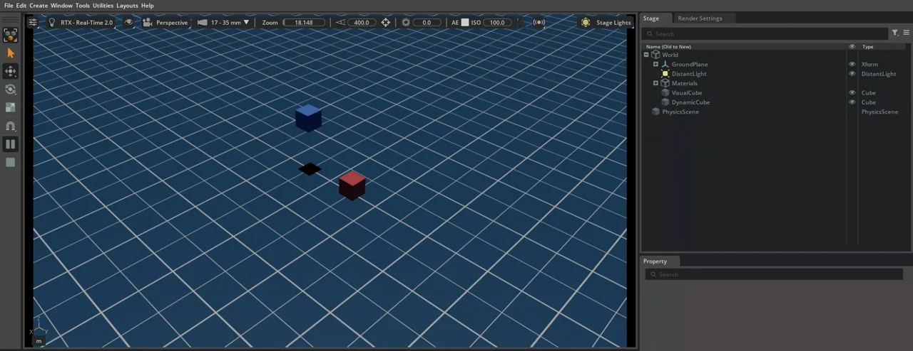

# 4. Python スタンドアロン入門

!!! info "この章で学ぶこと"
    Python のスクリプトから Isaac Sim を起動し、シーンを組み立てて、シミュレーションを 1 ステップずつ進める方法を学びます。5 章以降のサンプルは、すべてこの章の形で書かれています。

    - **所要時間**: 45 分
    - **前提**: 3 章
    - **対象バージョン**: Isaac Sim 6.1.0

## スタンドアロンスクリプトとは {#what-is-standalone}

2 章では、GUI のメニューから物体を置き、▶ ボタンで再生しました。同じことを Python で書いたものが **スタンドアロンスクリプト** です。スクリプトの中で Isaac Sim 本体を起動し、シーンを作り、シミュレーションを進め、最後に終了します。

GUI と比べて、次の点が便利です。

- **同じ手順を何度でも再現できる**: クリックの順番を覚えておく必要がない
- **細かく制御できる**: 1 ステップごとに値を読んだり、ロボットに指令を出したりできる
- **画面がなくても動く**: 画面を表示しない **ヘッドレス** モードで、計算だけを速く回せる

Isaac Sim には、Python を書く場所がほかにもあります (GUI の `Window > Script Editor` や、拡張機能 (Extension) など)。このチュートリアルでは、コンテナの中で `python.sh` から実行するスタンドアロンスクリプトだけを扱います。

この章のサンプルは `examples/04_python_standalone/` にあります。

| ファイル | 内容 |
| --- | --- |
| `01_hello_simulation_app.py` | Isaac Sim を起動して、終了するだけの最小のスクリプト |
| `02_build_scene.py` | 地面・ライト・立方体を置いて、シーンを保存する |
| `03_step_simulation.py` | 物理を 1 ステップずつ進め、落ちていく立方体の高さを表示する |

実行のしかたは [スクリプトをコンテナで実行する](#run-in-container) でまとめて説明します。先に試したい場合は、リポジトリのルートで次を実行してください。

```bash
docker compose -f docker/compose.yml run --rm --no-deps --entrypoint /isaac-sim/python.sh isaac-sim \
  /workspace/examples/04_python_standalone/01_hello_simulation_app.py
```

## SimulationApp の起動と終了 {#simulation-app}

スタンドアロンスクリプトは、必ず **`SimulationApp`** の起動から始まります。`SimulationApp` は Isaac Sim 本体 (Omniverse Kit というアプリケーションの土台) を立ち上げるクラスです。

```python title="examples/04_python_standalone/01_hello_simulation_app.py (抜粋)"
# 1. SimulationApp を起動する (Isaac Sim 本体が立ち上がる)
#    Isaac Sim のモジュールは、これより後でないと import できない
from isaacsim import SimulationApp

simulation_app = SimulationApp({"headless": True})

# 2. Isaac Sim のモジュールを import する
import omni.kit.app

app = omni.kit.app.get_app()
print(f"[hello] Kit のバージョン: {app.get_build_version()}")

# 3. アプリを数フレーム更新する
for _ in range(10):
    simulation_app.update()

# 4. 終了する
simulation_app.close()
```

流れは次の 4 段階です。

1. **起動**: `SimulationApp({...})` で Isaac Sim を起動する。`"headless": True` で画面を持たないモードになる
2. **import**: `isaacsim.core` や `omni` など Isaac Sim のモジュールを import する
3. **更新**: `simulation_app.update()` を呼ぶたびに、アプリが 1 フレーム進む (描画や、再生中なら物理の計算が行われる)
4. **終了**: `simulation_app.close()` で Isaac Sim を終了する

!!! warning "import の順番に注意"
    Isaac Sim のモジュール (`isaacsim.core...`、`omni...`、`pxr` など) は、`SimulationApp` を作った **後で** import してください。これらのモジュールは、起動した Isaac Sim の中でしか読み込めません。先に import すると `ModuleNotFoundError` などのエラーになります。

    そのため、このチュートリアルのサンプルでは、import 文がファイルの途中に出てきます。`argparse` など標準ライブラリの import や、コマンドライン引数の解析は、`SimulationApp` の前に書いてかまいません。

実行すると、大量のログの最後に次の 3 行が表示されます。

```text
[hello] SimulationApp の起動にかかった時間: 31.9 秒
[hello] Kit のバージョン: 110.3.0+feature.371399.00c488ae.gl
[hello] 10 フレーム更新しました
```

検証環境では、`SimulationApp` の起動だけで約 30 秒かかりました。コンテナの起動から終了までは約 36 秒です。Isaac Sim 6.1.0 は Kit 110.3 の上に作られていることもわかります。

!!! tip "途中で出る警告"
    実行中に `OmniHub: ... Hub encountered error`・`GLFW initialization failed`・`IOMMU is enabled` などの警告が出ます。ヘッドレスでコンテナの中から動かすときに出るもので、動作には影響しません ([付録 B の「互換性チェックの結果の読み方」](appendix/troubleshooting.md#compatibility-check))。

## シーンの構築 {#build-scene}

次は、2 章で GUI から作ったようなシーンを Python で組み立てます。`02_build_scene.py` では、地面とライトを置き、立方体を 2 つ作ります。

- **青い立方体**: 見た目だけ。物理を付けないので、空中に浮いたままになる
- **赤い立方体**: 剛体 (重力を受ける) とコリジョン (衝突判定) を付ける。落下して地面で止まる

```python title="examples/04_python_standalone/02_build_scene.py (抜粋)"
import isaacsim.core.experimental.utils.app as app_utils
import isaacsim.core.experimental.utils.stage as stage_utils
from isaacsim.core.experimental.materials import PreviewSurfaceMaterial
from isaacsim.core.experimental.objects import Cube, DistantLight, GroundPlane
from isaacsim.core.experimental.prims import GeomPrim, RigidPrim

# 1. 新しい Stage を作る
stage_utils.create_new_stage()

# 2. 地面とライトを置く
GroundPlane("/World/GroundPlane", positions=[0, 0, 0])
DistantLight("/World/DistantLight").set_intensities(300)

# 3. 色 (マテリアル) を作る
red = PreviewSurfaceMaterial("/World/Materials/red")
red.set_input_values("diffuseColor", [1.0, 0.2, 0.2])
blue = PreviewSurfaceMaterial("/World/Materials/blue")
blue.set_input_values("diffuseColor", [0.2, 0.4, 1.0])

# 4. 見た目だけの立方体 (物理なし: 空中に浮いたまま)
visual_cube = Cube(paths="/World/VisualCube", positions=[0.0, -0.5, 1.0], sizes=0.3)
visual_cube.apply_visual_materials(blue)

# 5. 物理付きの立方体 (剛体 + コリジョン: 落下して地面で止まる)
dynamic_cube = Cube(paths="/World/DynamicCube", positions=[0.0, 0.5, 1.0], sizes=0.3)
dynamic_cube.apply_visual_materials(red)
RigidPrim(paths="/World/DynamicCube")  # 剛体にする (重力を受ける)
GeomPrim(paths="/World/DynamicCube", apply_collision_apis=True)  # 衝突判定を付ける
```

### isaacsim.core.experimental の API {#core-experimental}

このチュートリアルでは、Isaac Sim 6.1.0 の **`isaacsim.core.experimental`** の API を使います。主なモジュールは次のとおりです。

| モジュール | 役割 | この章で使うもの |
| --- | --- | --- |
| `utils.stage` | Stage の作成・保存・アセットの読み込み | `create_new_stage()`、`save_stage()` |
| `utils.app` | 再生・停止・拡張機能の有効化 | `play()`、`stop()` |
| `objects` | 形状やライトの Prim を作る | `Cube`、`GroundPlane`、`DistantLight` |
| `materials` | 色や質感 (マテリアル) | `PreviewSurfaceMaterial` |
| `prims` | 既存の Prim を包んで、物理などの性質を付けたり値を読み書きしたりする | `RigidPrim`、`GeomPrim` |

!!! note "古い API との違い"
    インターネット上の記事や古いバージョンのサンプルには、`omni.isaac.core` や `isaacsim.core.api` の `World` クラスを使ったものが多くあります。Isaac Sim 6.1.0 の公式サンプル (standalone_examples) は `isaacsim.core.experimental` に移っているため、このチュートリアルもそれに合わせています。名前に `experimental` とありますが、6.1.0 の公式サンプルの多くがこの API で書かれています。

`Cube(paths=..., positions=..., sizes=...)` のように、引数が複数形になっているのも特徴です。この API は、同じ種類の Prim をまとめて扱えるように作られています。`paths` にパスのリストを渡すと、複数の立方体を一度に作れます。この章では 1 つずつしか作らないので、パスは文字列で渡しています。

### Stage のツリーを確かめる {#stage-tree}

スクリプトの続きでは、Stage のツリーを表示し、USD ファイルとして保存しています。

```python title="examples/04_python_standalone/02_build_scene.py (抜粋)"
print(stage_utils.generate_stage_representation())
stage_utils.save_stage(args.save)
```

表示されるツリーの `/World` の部分は次のとおりです。

```text
├─ World ()
│  ├─ GroundPlane (Xform)
│  │  ├─ geom (Mesh)
│  │  ├─ collisionPlane (Plane)
│  │  ├─ visualMaterial (Material)
│  │  │  ├─ Shader (Shader)
│  ├─ DistantLight (DistantLight)
│  ├─ Materials ()
│  │  ├─ red (Material)
│  │  │  ├─ Shader (Shader)
│  │  ├─ blue (Material)
│  │  │  ├─ Shader (Shader)
│  ├─ VisualCube (Cube)
│  ├─ DynamicCube (Cube)
```

ツリーには `/World` のほかに、`/Render` や `/OmniverseKit_Persp` (ビューポートのカメラ) も表示されます。これらは Isaac Sim が自動で作る Prim です。

保存された `.usda` ファイルを開くと、2 つの立方体の違いがわかります。

```usda title="04_scene.usda (抜粋)"
def Cube "VisualCube" (
    prepend apiSchemas = ["MaterialBindingAPI"]
)

def Cube "DynamicCube" (
    prepend apiSchemas = ["MaterialBindingAPI", "PhysicsRigidBodyAPI", "PhysxRigidBodyAPI", "PhysicsCollisionAPI", "PhysicsMeshCollisionAPI", "PhysxCollisionAPI"]
)
```

`RigidPrim` と `GeomPrim(apply_collision_apis=True)` は、Prim に `PhysicsRigidBodyAPI` (剛体) や `PhysicsCollisionAPI` (衝突判定) といった **API スキーマ** を付けています。2 章で GUI から `Add > Physics > Rigid Body with Colliders Preset` を選んだときと同じことを、Python から行っているわけです。

### 画面で確かめる {#build-scene-livestream}

`02_build_scene.py` に `--livestream` を付けて実行すると、Web ビューアで画面を見られます (手順は [Web ビューアで画面を見ながら実行する](#run-with-livestream))。



赤い立方体は地面に落ちて止まり、青い立方体は空中に浮いたままです。右上の Stage パネルには `PhysicsScene` があります。保存したツリーにはなかった Prim で、再生 (`app_utils.play()`) したときに Isaac Sim が自動で作ります。重力の向きや大きさは、この `PhysicsScene` が持っています。

## シミュレーションのステップ実行 {#step-simulation}

`03_step_simulation.py` では、高さ 2 m から立方体を落とし、物理を 1 ステップずつ進めながら高さを表示します。

```python title="examples/04_python_standalone/03_step_simulation.py (抜粋)"
PHYSICS_DT = 1.0 / 60.0  # 1 ステップ = 1/60 秒

# 物理ステップの時間幅 (dt) を設定する
SimulationManager.set_physics_dt(PHYSICS_DT)

# タイムラインを再生する (GUI の ▶ ボタンに相当)
app_utils.play()
simulation_app.update()  # 物理エンジンを初期化する


def cube_height() -> float:
    positions, _ = cube.get_world_poses()  # 戻り値は warp の配列
    return float(positions.numpy()[0, 2])


for episode in range(2):
    # 立方体を初期位置に戻す (リセット)
    cube.set_world_poses(
        positions=[[0.0, 0.0, INITIAL_HEIGHT]],
        orientations=[[1.0, 0.0, 0.0, 0.0]],  # 回転なし (w, x, y, z)
    )
    cube.set_velocities(linear_velocities=[0, 0, 0], angular_velocities=[0, 0, 0])

    for step in range(120):  # 120 ステップ = 2 秒
        SimulationManager.step()  # 物理だけを 1 ステップ進める (描画はしない)
        if step % 10 == 0:
            t = (step + 1) * PHYSICS_DT
            print(f"t = {t:4.2f} 秒  高さ = {cube_height():.3f} m")
```

### 再生とステップ {#play-and-step}

物理シミュレーションを進めるには、まず **再生** (`app_utils.play()`) します。GUI の ▶ ボタンを押すのと同じです。再生していない間は、`update()` を呼んでも物理は進みません。

再生したあとで時間を進める方法は 2 つあります。

| 呼び出し | 進むもの | 使いどころ |
| --- | --- | --- |
| `simulation_app.update()` | 物理を 1 ステップ + 描画 + アプリ全体 | 画面に映したいとき、カメラや LiDAR のデータを取るとき (5 章以降) |
| `SimulationManager.step()` | 物理だけを 1 ステップ | 描画が要らず、物理の計算だけを速く進めたいとき |

1 ステップで進む時間 (**dt**) は `SimulationManager.set_physics_dt()` で決めます。ここでは 1/60 秒にしているので、120 ステップで 2 秒進みます。5 章のサンプルでは、`simulation_app.update()` 1 回で物理が 1/60 秒進むことも確かめています。

!!! note "シミュレーションの時間と実際の時間"
    1 ステップの計算にかかる実際の時間は、シーンの重さや PC の性能で変わります。シミュレーションの中の時間 (dt × ステップ数) と、実際に経過した時間は一致しません。`03_step_simulation.py` はシミュレーションの中で約 4 秒進みますが、物理の計算そのものは一瞬で終わります (実行時間のほとんどは Isaac Sim の起動です)。

### 値の読み書き {#read-and-write}

`RigidPrim` は、剛体の位置や速度を読み書きするためのクラスでもあります。

- `get_world_poses()`: 位置と姿勢 (四元数) を返す
- `set_world_poses()`: 位置と姿勢を設定する。ここでは立方体を初期位置に戻す (リセットする) のに使っている
- `set_velocities()`: 速度を設定する。リセットするときは、落ちていた速度も 0 に戻す

姿勢の四元数は、3 章で説明したとおり `(w, x, y, z)` の順です。`[1.0, 0.0, 0.0, 0.0]` は「回転なし」を表します。

!!! tip "戻り値は warp の配列"
    `get_world_poses()` などの戻り値は、NVIDIA の GPU 計算ライブラリ **warp** の配列です。NumPy で扱いたいときは、`.numpy()` で変換します。複数の Prim をまとめて扱える API なので、配列の最初の次元は Prim の番号です。1 つ目の立方体の z 座標 (高さ) は `positions.numpy()[0, 2]` で取り出せます。

### 実行結果 {#step-simulation-output}

```text
--- エピソード 0 ---
t = 0.02 秒  高さ = 1.997 m
t = 0.18 秒  高さ = 1.820 m
t = 0.35 秒  高さ = 1.371 m
t = 0.52 秒  高さ = 0.648 m
t = 0.68 秒  高さ = 0.100 m
t = 0.85 秒  高さ = 0.100 m
...
t = 1.85 秒  高さ = 0.100 m
--- エピソード 1 ---
t = 0.02 秒  高さ = 1.997 m
t = 0.18 秒  高さ = 1.820 m
...
シミュレーション時間の合計: 4.05 秒
```

- 高さは 2 m から減っていき、約 0.68 秒で **0.100 m** になって止まります。立方体の大きさが 0.2 m なので、底面が地面に着いたときの中心の高さが 0.1 m です
- 2 回目のエピソードも 1.997 m から始まり、同じように落ちます。`set_world_poses()` によるリセットが効いています

!!! note "自由落下と比べる"
    重力加速度を 9.81 m/s² とすると、2 m から 0.1 m (1.9 m) 落ちるのにかかる時間は √(2 × 1.9 / 9.81) ≈ 0.62 秒です。表示は 10 ステップおきなので、0.52 秒と 0.68 秒の間で着地していることと合っています。

## スクリプトをコンテナで実行する {#run-in-container}

ここまでのサンプルを実行するコマンドを、もう一度見てみます。

```bash
docker compose -f docker/compose.yml run --rm --no-deps --entrypoint /isaac-sim/python.sh isaac-sim \
  /workspace/examples/04_python_standalone/01_hello_simulation_app.py
```

| 部分 | 意味 |
| --- | --- |
| `docker compose -f docker/compose.yml run` | `compose.yml` のサービスの設定 (GPU・マウント・ユーザー) で、使い捨てのコンテナを作って実行する |
| `--rm` | 終わったらコンテナを削除する |
| `--no-deps` | 依存するサービス (`web-viewer`) を起動しない |
| `--entrypoint /isaac-sim/python.sh` | Isaac Sim の GUI ではなく、Isaac Sim に同梱の Python を起動する |
| `isaac-sim` | 使うサービスの名前 |
| `/workspace/examples/...` | 実行するスクリプト。リポジトリの `examples/` はコンテナの `/workspace/examples` にマウントされている |

!!! warning "Python は `python.sh` で実行する"
    `SimulationApp` を使うスクリプトは、コンテナの `/isaac-sim/python.sh` で実行してください。`python.sh` は、Isaac Sim に必要なライブラリの場所を設定してから、同梱の Python 3.12 を起動します。ホストの Python や、コンテナの中の別の `python3` では `isaacsim` を import できません。

`up -d` で起動した `isaac-sim` サービスとは別のコンテナなので、GUI を使わないときは先に `docker compose -f docker/compose.yml down` しておくと、GPU のメモリを節約できます ([1 章](01-setup.md#stop-and-restart))。

### 出力を保存する {#save-output}

`examples/` は読み取り専用でマウントされているので、スクリプトの出力はほかの場所に書きます。`02_build_scene.py` は既定ではコンテナの `/tmp/output/04_scene.usda` に保存しますが、コンテナの `/tmp` はコンテナを削除すると消えてしまいます。

ホストに残したいときは、1 章で作った `~/docker/isaac-sim/data` (コンテナの `/isaac-sim/.local/share/ov/data`) を保存先に指定します。

```bash
docker compose -f docker/compose.yml run --rm --no-deps --entrypoint /isaac-sim/python.sh isaac-sim \
  /workspace/examples/04_python_standalone/02_build_scene.py \
  --save /isaac-sim/.local/share/ov/data/output/04/04_scene.usda
```

ファイルはホストの `~/docker/isaac-sim/data/output/04/04_scene.usda` にできます。テキストエディタで開いたり、Isaac Sim の `File > Open` で開いたりできます。ホストのディレクトリをマウントして保存する方法と、保存できないときの対処は [付録 B の「サンプルの出力ファイルを保存できない」](appendix/troubleshooting.md#output-permission) を参照してください。

### Web ビューアで画面を見ながら実行する {#run-with-livestream}

`--livestream` を付けると、スクリプトの画面を Web ビューアで見られます。`isaac-sim` サービスとスクリプトが同じストリーミング用のポートを使うため、先に `isaac-sim` サービスを止め、`web-viewer` だけを起動しておきます。

```bash
docker compose -f docker/compose.yml stop isaac-sim
docker compose -f docker/compose.yml up -d --no-deps web-viewer

docker compose -f docker/compose.yml run --rm --no-deps --entrypoint /isaac-sim/python.sh isaac-sim \
  /workspace/examples/04_python_standalone/02_build_scene.py --livestream
```

ログに `シーンを保存しました` と表示されたら、ブラウザで `http://localhost:8210` を開きます。スクリプトを終わらせるには、実行したターミナルで ++ctrl+c++ を押します (検証環境では 2 秒ほどで終了しました)。

!!! tip "画面が黒いままのとき"
    接続した直後、Web ビューアの画面が黒いままのことがあります。ビューポートの上でマウスを動かすと表示されます。

スクリプトの中では、`--livestream` のときに次の 3 つを行っています。

```python title="examples/04_python_standalone/02_build_scene.py (抜粋)"
simulation_app = SimulationApp({"headless": True, "hide_ui": not args.livestream})

if args.livestream:
    simulation_app.set_setting("/app/window/drawMouse", True)
    app_utils.enable_extension("omni.kit.livestream.app")

# livestream のときは、ブラウザを閉じるまで (またはアプリが終了するまで) 表示を続ける
while args.livestream and simulation_app.is_running():
    simulation_app.update()
```

- `"hide_ui": False` で、メニューや Stage パネルなどの UI を表示する
- 拡張機能 `omni.kit.livestream.app` を有効にして、画面を WebRTC で配信する
- シミュレーションが終わってもすぐに閉じず、`update()` を呼び続けて画面を表示しておく

5 章以降のサンプルも、`--livestream` を付ければ同じように画面を見られます。

## まとめ {#summary}

- スタンドアロンスクリプトは、Python から Isaac Sim を起動し、シーンの構築からシミュレーションまでを行う
- 最初に `SimulationApp` を起動し、Isaac Sim のモジュールはその **後で** import する。最後は `close()` で終了する
- シーンは `isaacsim.core.experimental` の `objects`・`materials`・`prims` で組み立てる。物理を付けるのは `RigidPrim` (剛体) と `GeomPrim(apply_collision_apis=True)` (衝突判定)
- `app_utils.play()` で再生し、`simulation_app.update()` (描画あり) か `SimulationManager.step()` (物理のみ) で時間を進める。1 ステップの時間は dt で決まる
- スクリプトは `docker compose run ... --entrypoint /isaac-sim/python.sh isaac-sim` で実行する。画面を見たいときは `--livestream` を付ける

## 演習 {#exercises}

1. `02_build_scene.py` で保存した `04_scene.usda` をテキストエディタで開き、`VisualCube` と `DynamicCube` の `apiSchemas` を見比べてください。
2. `03_step_simulation.py` の `INITIAL_HEIGHT` を `5.0` に変えて実行し、着地するまでの時間がどう変わるかを確かめてください。自由落下の式 √(2h / g) で求めた時間と比べてみましょう。
3. `03_step_simulation.py` の `PHYSICS_DT` を `1.0 / 30.0` に変えると、120 ステップで何秒進むでしょうか。予想してから実行して確かめてください。
4. `02_build_scene.py` に、緑色の物理付きの立方体を 1 つ追加してください。青い立方体の真上 (たとえば高さ 2 m) に置くと、どうなるでしょうか。`--livestream` で確かめてみましょう。

## 参考リンク {#references}

- [Python Environment (Isaac Sim ドキュメント)](https://docs.isaacsim.omniverse.nvidia.com/6.1.0/installation/install_python.html)
- [Workflows (Isaac Sim ドキュメント)](https://docs.isaacsim.omniverse.nvidia.com/6.1.0/introduction/workflows.html)
- [Core Experimental API (Isaac Sim ドキュメント)](https://docs.isaacsim.omniverse.nvidia.com/6.1.0/py/source/extensions/isaacsim.core.experimental.prims/docs/index.html)
- [standalone_examples (Isaac Sim v6.1.0、GitHub)](https://github.com/isaac-sim/IsaacSim/tree/v6.1.0/source/standalone_examples)
- [Livestream Clients (Isaac Sim ドキュメント)](https://docs.isaacsim.omniverse.nvidia.com/6.1.0/installation/manual_livestream_clients.html)
