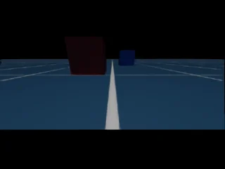
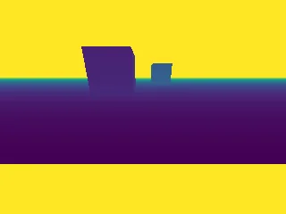
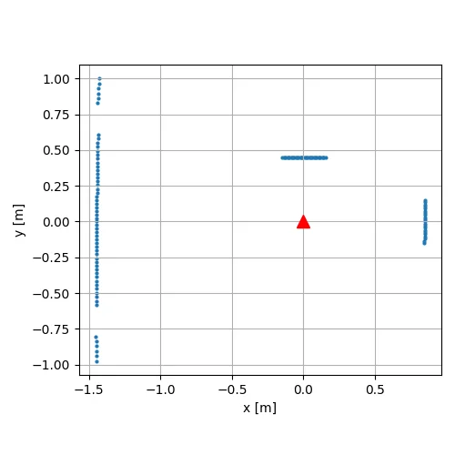
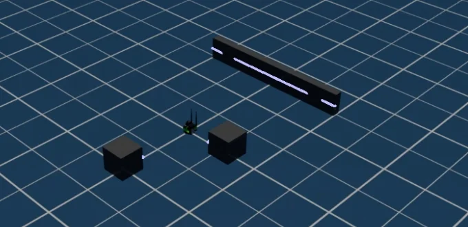

# 6. センサ

!!! info "この章で学ぶこと"
    Jetbot にカメラと LiDAR を取り付け、データを取得・保存する

    - **所要時間**: 60 分
    - **前提**: 5 章
    - **対象バージョン**: Isaac Sim 6.1.0

5 章では、Jetbot の位置や向きをシミュレータから直接読み取って走らせました。実際のロボットは、自分の位置や周りの様子を **センサ** で知ります。この章では、Jetbot にもともと付いているカメラから画像を取り出し、さらに LiDAR (レーザーで周囲の距離を測るセンサ) を後から取り付けます。7 章では、この章の LiDAR を使って障害物を避けます。

この章のサンプルコードは `examples/06_sensors/` にあります。

| ファイル | 内容 |
| --- | --- |
| `01_camera.py` | Jetbot のカメラから RGB 画像と Depth 画像を取得し、PNG で保存する |
| `02_lidar.py` | Jetbot に 2D LiDAR を後付けし、前後左右の物体までの距離を測る |

どちらも公式の standalone_examples (v6.1.0) の `isaacsim.sensors.experimental.rtx` にあるサンプルをもとにしています。

!!! tip "サンプルの実行方法"
    この章のサンプルは画像や図をファイルに保存します。保存先の指定方法は [センサデータを保存する](#save-data) で説明します。まずは次のコマンドで実行してください。画像はホストの `~/docker/isaac-sim/data/output/` にできます。

    ```bash
    docker compose -f docker/compose.yml run --rm --no-deps --entrypoint /isaac-sim/python.sh isaac-sim \
      /workspace/examples/06_sensors/01_camera.py --output /isaac-sim/.local/share/ov/data/output/06_camera
    ```

## カメラ (RGB / Depth) {#camera}

### Jetbot のカメラ {#jetbot-camera}

Jetbot の USD には、車体の前方を向いたカメラの Prim がすでに入っています。パスは `/World/Jetbot/chassis/rgb_camera/jetbot_camera` です (Jetbot を `/World/Jetbot` に置いた場合)。

ただし、USD のカメラは「どこから、どの画角で見るか」を表すだけで、それだけでは画像を取り出せません。画像を取り出すには、カメラの Prim に **センサ** としての仕組みを取り付けます。

```python title="examples/06_sensors/01_camera.py (抜粋)"
from isaacsim.sensors.experimental.rtx import CameraSensor

# Jetbot の USD の中にあるカメラの Prim のパス
JETBOT_CAMERA = "/World/Jetbot/chassis/rgb_camera/jetbot_camera"
RESOLUTION = (240, 320)  # (高さ, 幅) [ピクセル]

# 既存のカメラの Prim に「センサとしてデータを取り出す仕組み」を取り付ける
#   rgb: 色の画像 / distance_to_image_plane: 画像の面からの距離 [m] (Depth 画像)
camera = CameraSensor(
    JETBOT_CAMERA,
    resolution=RESOLUTION,
    annotators=["rgb", "distance_to_image_plane"],
)
```

`annotators` には、取り出したいデータの種類を並べます。この **アノテータ** (annotator) は、描画結果から特定のデータを取り出す部品です。ここでは次の 2 つを使います。

| アノテータ | 取り出せるデータ |
| --- | --- |
| `rgb` | 色の画像 (高さ × 幅 × 3、`uint8`) |
| `distance_to_image_plane` | 画素ごとの、画像の面から物体までの距離 [m] (Depth 画像) |

シーンには、カメラに写す物体として、手前 (0.6 m 先) に赤、奥 (1.2 m 先) に青の立方体を置いています。

### データが届くまで待つ {#wait-for-data}

カメラのデータは、描画が何フレームか進んでから届きます。そこで、`simulation_app.update()` でフレームを進めながら、`get_data()` で中身が入っているかを確かめます。

```python title="examples/06_sensors/01_camera.py (抜粋)"
# カメラのデータは、描画が何フレームか進んでから届く。届くまで待つ
rgb = depth = None
for frame in range(300):
    simulation_app.update()
    rgb_data, _ = camera.get_data("rgb")
    depth_data, _ = camera.get_data("distance_to_image_plane")
    if rgb_data is not None and depth_data is not None and rgb_data.size > 0:
        rgb = rgb_data.numpy()
        depth = depth_data.numpy().squeeze()  # (高さ, 幅, 1) → (高さ, 幅)
        print(f"[camera] {frame + 1} フレーム目でデータを取得しました")
        break
```

`get_data()` が返すデータは、`.numpy()` で NumPy の配列に変換できます。

実行すると、次のように表示されます。

```text
[camera] 3 フレーム目でデータを取得しました
RGB   : shape = (240, 320, 3), dtype = uint8
Depth : shape = (240, 320), dtype = float32
Depth : 画像の中央までの距離 = 0.27 m
[camera] 画像を保存しました: /isaac-sim/.local/share/ov/data/output/06_camera
```

検証環境では 3 フレーム目でデータが届きました。画像の中央は Jetbot の少し前の床なので、距離は 0.27 m になっています。

### 保存された画像 {#camera-images}

保存された 2 枚の画像です。左が RGB 画像、右が Depth 画像です。




- RGB 画像では、左手前に赤、右奥に青の立方体が写っています。画像の上下には黒い帯が入ります
- Depth 画像は、距離を色で表しています (近いほど暗い紫、遠いほど黄色)。手前の赤い立方体のほうが、奥の青い立方体より暗い色 (近い) になっています

何も写っていない画素 (空など) は、距離が無限大 (`inf`) になります。そのままでは画像にできないので、保存するときに 3 m までに区切っています (`depth.clip(0.0, 3.0)`)。

## LiDAR を取り付ける {#lidar}

### LiDAR とは {#what-is-lidar}

**LiDAR** は、レーザーを出して、物体に当たって返ってくるまでの時間から距離を測るセンサです。回転しながら測ることで、周囲 360 度の距離がわかります。この章では、水平方向の一周だけを測る **2D LiDAR** を Jetbot に取り付けます。

Isaac Sim 6.1.0 の LiDAR は **RTX LiDAR** で、カメラと同じく RTX のレイトレーシングで計算されます。公式の推奨 GPU より古い検証環境の RTX 2080 Ti でも、問題なく動きました。

### LiDAR を作る {#create-lidar}

LiDAR は `Lidar.create()` で作ります。Jetbot の車体 (`chassis`) の子として作ると、車体と一緒に動きます。

```python title="examples/06_sensors/02_lidar.py (抜粋)"
from isaacsim.sensors.experimental.rtx import Lidar, LidarSensor

# LiDAR を Jetbot の車体 (chassis) の子として作る。車体と一緒に動くようになる
#   Example_Rotary_2D: 水平方向の一周を測る 2D LiDAR の設定
lidar = Lidar.create(
    "/World/Jetbot/chassis/lidar",
    config="Example_Rotary_2D",
    translations=[0.0, 0.0, 0.12],  # 車体の上 12 cm に取り付ける
)
```

`config` には、LiDAR の設定 (測る範囲、本数、回転の速さなど) の名前を指定します。`Example_Rotary_2D` は、Isaac Sim に入っている 2D LiDAR の設定例です。

### 近い物体も測れるように設定を変える {#near-range}

`Example_Rotary_2D` の設定のままでは、Jetbot の近くにある物体を検出しません。検証環境では、この章のシーンで前と左の箱 (0.85 m と 0.45 m) までの距離が測れず、無限大になりました。原因は次の 2 つの設定です。

| 属性 | `Example_Rotary_2D` の値 | 意味 |
| --- | --- | --- |
| `omni:sensor:Core:nearRangeM` | 1 | これより近い点を捨てる [m] |
| `omni:sensor:Core:minDistBetweenEchosM` | 0.4 | 検証環境では、約 0.4 m より近い点も出てこなかった |

Jetbot は小さなロボットで、まわりの数十 cm の物体も測りたいので、この 2 つを変えます。最小距離は、Jetbot 自身 (LiDAR から約 8 cm 先のアンテナ) を測らないように 10 cm にします。

```python title="examples/06_sensors/02_lidar.py (抜粋)"
lidar_prim = stage_utils.get_current_stage().GetPrimAtPath("/World/Jetbot/chassis/lidar")
lidar_prim.GetAttribute("omni:sensor:Core:nearRangeM").Set(0.1)
lidar_prim.GetAttribute("omni:sensor:Core:minDistBetweenEchosM").Set(0.0)
```

LiDAR の設定は Prim の属性になっているので、3 章と同じように `GetAttribute()` と `Set()` で変えられます。

### 測定結果を取り出す {#lidar-data}

カメラと同じく、LiDAR にもセンサとしての仕組みを取り付け、アノテータでデータを取り出します。

```python title="examples/06_sensors/02_lidar.py (抜粋)"
# generic-model-output: LiDAR の測定結果 (点ごとの方位角・仰角・距離など)
sensor = LidarSensor(lidar, annotators=["generic-model-output"])
```

`generic-model-output` (GMO) は、点ごとの測定結果をまとめたデータです。`parse_generic_model_output_data()` で読み取ると、点ごとの値を取り出せます。既定の形式 (球座標) では、`x` が方位角 [度]、`y` が仰角 [度]、`z` が距離 [m] です。

```python title="examples/06_sensors/02_lidar.py (抜粋)"
data, _ = sensor.get_data("generic-model-output")
gmo = parse_generic_model_output_data(data)
# 既定の座標の形式 (球座標) では、x = 方位角 [度]、y = 仰角 [度]、z = 距離 [m]
azimuths, ranges = np.asarray(gmo.x), np.asarray(gmo.z)
scan.update(azimuths, ranges, now=frame * PHYSICS_DT)
```

LiDAR は回転しながら少しずつ測るので、1 回の `get_data()` で一周分がそろうとは限りません。そこで、サンプルの `LidarScan` クラスで、方向 (方位角) を 1 度ずつの区画に分け、区画ごとに最新の距離を覚えておきます。しばらく点が届かない区画は「何もない (距離 = 無限大)」とみなします。7 章でも、このクラスを使います。

### 実行結果 {#lidar-output}

シーンには、前方 1.0 m に箱、左 0.6 m に箱、後方 1.5 m に横長の壁を置いています (箱は 1 辺 0.3 m、壁の厚さは 0.1 m)。実行すると、次のように表示されます。

```text
[lidar] フレーム 30: 142934 点 (方位角 -180〜180 度)
[lidar] フレーム 60: 142959 点 (方位角 -180〜180 度)
[lidar] フレーム 90: 142932 点 (方位角 -180〜180 度)
--- 各方向で一番近い物体までの距離 (幅 10 度) ---
前 (0 度)      0.85 m
左 (90 度)     0.45 m
後 (180 度)    1.45 m
右 (270 度)    inf m
[lidar] 図を保存しました: /isaac-sim/.local/share/ov/data/output/06_lidar/scan.png
```

- 1 回に約 14 万点のデータが届きます
- 距離は、物体の中心ではなく、Jetbot 側の面までの距離です。たとえば前の箱は中心が 1.0 m 先で、1 辺が 0.3 m なので、面までは 0.85 m です
- 右には何も置いていないので、無限大 (`inf`) になります

!!! note
    終了するときに `getModelOutputPtrFromBuffer:: GMO magic number is not correct` という行が何度か表示されますが、結果には影響しません。

保存された図 (`scan.png`) は、Jetbot (赤い三角、前方 = +X) を中心に、上から見た点の位置です。前の箱・左の箱・後ろの壁の 3 つの面が見えます。



### 点群を Web ビューアで見る {#lidar-livestream}

`--livestream` を付けて実行すると、LiDAR の点を画面に描きます。Web ビューア (`http://localhost:8210`) で接続し、再生 (▶) を押すと測定が始まります。

```bash
docker compose -f docker/compose.yml run --rm --no-deps --entrypoint /isaac-sim/python.sh isaac-sim \
  /workspace/examples/06_sensors/02_lidar.py --livestream \
  --output /isaac-sim/.local/share/ov/data/output/06_lidar
```

壁と箱の、Jetbot 側の面に白い線が描かれます。これが LiDAR の点です。



点を描いているのは、次の 1 行です。

```python title="examples/06_sensors/02_lidar.py (抜粋)"
if args.livestream:
    sensor.attach_writer("draw-point-cloud")  # 点群を画面に描く
```

終了するときは、ターミナルで ++ctrl+c++ を押します。

## センサデータを保存する {#save-data}

この章のサンプルは、取り出したデータを matplotlib で PNG に保存しています。

```python title="examples/06_sensors/01_camera.py (抜粋)"
output_dir = Path(args.output)
output_dir.mkdir(parents=True, exist_ok=True)
plt.imsave(output_dir / "rgb.png", rgb)
plt.imsave(output_dir / "depth.png", depth.clip(0.0, 3.0), cmap="viridis")
```

保存先は `--output` で指定します。指定しないときは、コンテナの中の `/tmp/output/06_camera` (LiDAR は `/tmp/output/06_lidar`) です。コンテナの中に保存したファイルは、`--rm` で実行するとコンテナと一緒に消えてしまいます。ホストから見るには、ホストのディレクトリがマウントされている場所に保存します。

### 1 章で作ったデータ用ディレクトリに保存する (おすすめ) {#save-to-data-dir}

1 章で作った `~/docker/isaac-sim/data` は、コンテナの `/isaac-sim/.local/share/ov/data` にマウントされています。この下を `--output` に指定すると、ホストから画像を見られます。

```bash
docker compose -f docker/compose.yml run --rm --no-deps --entrypoint /isaac-sim/python.sh isaac-sim \
  /workspace/examples/06_sensors/01_camera.py --output /isaac-sim/.local/share/ov/data/output/06_camera
```

画像はホストの `~/docker/isaac-sim/data/output/06_camera/` にできます。所有者は uid 1234 なので、ホストのユーザーは読めますが、書き換えや削除はできません。

### 別のディレクトリをマウントして保存する {#save-to-mount}

リポジトリの中など、好きな場所に保存したいときは、`-v` でディレクトリを追加でマウントします。

```bash
mkdir -p output
docker compose -f docker/compose.yml run --rm --no-deps -v "$PWD/output:/tmp/output" \
  --entrypoint /isaac-sim/python.sh isaac-sim \
  /workspace/examples/06_sensors/01_camera.py
```

コンテナの Isaac Sim は uid 1234 のユーザーで動くので、マウントするディレクトリは uid 1234 が書き込める必要があります。

!!! warning "画像ができていないとき"
    保存先に書き込めないと `PermissionError` が出ますが、スクリプトの終了コードは 0 (成功) になります。画像ができていないときは、ログに `PermissionError` がないか確認してください。対処は [付録 B: サンプルの出力ファイルを保存できない](appendix/troubleshooting.md#output-permission) を参照してください。

## まとめ {#summary}

- USD のカメラは「どこから見るか」を表すだけ。`CameraSensor` を取り付けると、画像を取り出せる
- 取り出すデータの種類は **アノテータ** で選ぶ。RGB 画像は `rgb`、Depth 画像は `distance_to_image_plane`
- センサのデータは数フレーム後に届く。`simulation_app.update()` で進めながら `get_data()` で確かめる
- LiDAR は `Lidar.create()` で作る。ロボットのリンクの子にすると一緒に動く
- `Example_Rotary_2D` のままでは近い物体を測れないので、`nearRangeM` と `minDistBetweenEchosM` を変える
- LiDAR の測定結果は `generic-model-output` で取り出し、`parse_generic_model_output_data()` で方位角と距離を読む
- 保存した画像をホストで見るには、マウントされた場所 (`/isaac-sim/.local/share/ov/data` など) に保存する

## 演習 {#exercises}

1. `01_camera.py` の `RESOLUTION` を `(480, 640)` に変えて、画像がどう変わるか確かめてください。
2. `01_camera.py` で赤い立方体の位置を変え、Depth 画像の色と `画像の中央までの距離` がどう変わるかを確かめてください (ヒント: 立方体を画像の中央に写すには、Jetbot の正面 (y = 0) に置きます)。
3. `02_lidar.py` で `nearRangeM` と `minDistBetweenEchosM` を変える 2 行をコメントアウトして実行し、前と左の距離が `inf` になることを確かめてください。
4. `02_lidar.py` の右側 (y がマイナスの方向) に箱を 1 つ追加して、`右 (270 度)` の距離が測れるようにしてください。

## 参考リンク {#references}

- [Camera Sensors (Isaac Sim ドキュメント)](https://docs.isaacsim.omniverse.nvidia.com/6.1.0/sensors/isaacsim_sensors_camera.html)
- [RTX Sensors (Isaac Sim ドキュメント)](https://docs.isaacsim.omniverse.nvidia.com/6.1.0/sensors/isaacsim_sensors_rtx.html)
- [RTX Lidar Sensor (Isaac Sim ドキュメント)](https://docs.isaacsim.omniverse.nvidia.com/6.1.0/sensors/isaacsim_sensors_rtx_lidar.html)
- [isaacsim.sensors.experimental.rtx API (Isaac Sim ドキュメント)](https://docs.isaacsim.omniverse.nvidia.com/6.1.0/py/source/extensions/isaacsim.sensors.experimental.rtx/docs/index.html)
- [create_camera_basic.py (standalone_examples v6.1.0、GitHub)](https://github.com/isaac-sim/IsaacSim/blob/v6.1.0/source/standalone_examples/api/isaacsim.sensors.experimental.rtx/create_camera_basic.py)
- [lidar_robot_integration.py (standalone_examples v6.1.0、GitHub)](https://github.com/isaac-sim/IsaacSim/blob/v6.1.0/source/standalone_examples/api/isaacsim.sensors.experimental.rtx/lidar_robot_integration.py)
- [inspect_lidar_gmo.py (standalone_examples v6.1.0、GitHub)](https://github.com/isaac-sim/IsaacSim/blob/v6.1.0/source/standalone_examples/api/isaacsim.sensors.experimental.rtx/inspect_lidar_gmo.py)
