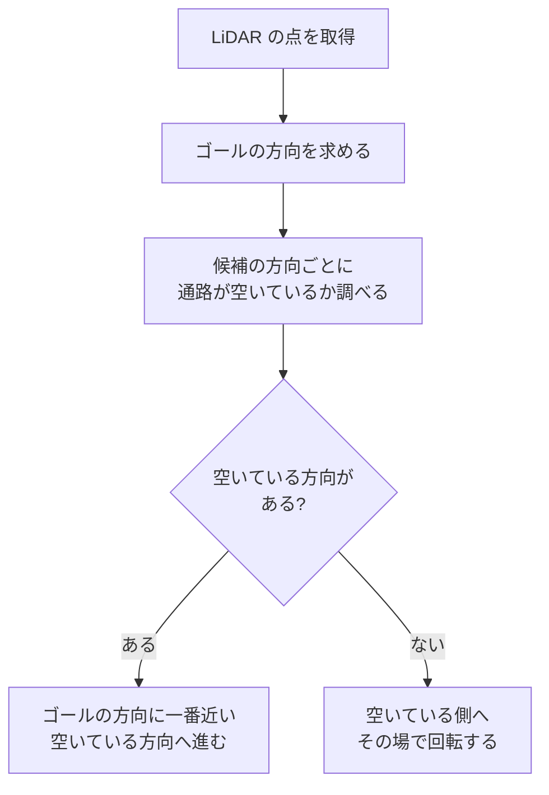
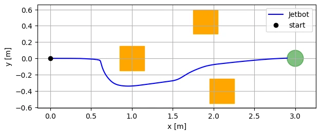

# 7. ミニプロジェクト: 障害物を避けてゴールへ

!!! info "この章で学ぶこと"
    LiDAR を使って障害物を避けながらゴールへ向かう Jetbot を作る

    - **所要時間**: 90 分
    - **前提**: 6 章
    - **対象バージョン**: Isaac Sim 6.1.0

この章で作る Jetbot の動きです (5 倍速)。LiDAR で箱を見つけ (箱の面の白い線が LiDAR の点)、避けながら緑のゴールへ向かいます。

<video src="assets/07-mini-project/lidar-obstacle-avoidance.mp4" controls muted loop playsinline width="100%"></video>

## 課題の説明 {#task}

5 章では、Jetbot の位置と向きを見ながら目標地点へ向かわせました。ただし、途中に障害物があると、そのままぶつかってしまいます。6 章では、LiDAR で周囲の物体までの距離を測りました。

この章では、この 2 つを組み合わせて、次のような Jetbot を作ります。

- スタート (原点) から、3 m 先のゴールへ向かう
- 途中にある 3 つの箱を、LiDAR で見つけて避ける
- 60 秒以内にゴール (半径 0.1 m の円) に着けば成功

サンプルコードは `examples/07_mini_project/lidar_obstacle_avoidance.py` の 1 本です。5 章と 6 章のコードを組み合わせて作っているので、新しい API はほとんど出てきません。この章の中心は、**LiDAR の距離から、どちらへ進むかを決める考え方** です。

!!! note "ロボットの位置について"
    このサンプルでは、5 章と同じく Jetbot の位置と向きをシミュレータから直接読み取っています (ゴールの方向を求めるため)。実際のロボットでは、車輪の回転やセンサから自分の位置を推定する必要があります。障害物は、シミュレータの情報ではなく LiDAR だけで見つけます。

## シーンの準備 {#scene}

シーンは、6 章までと同じく地面・ライト・Jetbot・LiDAR に、障害物の箱とゴールの目印を加えたものです。

```python title="examples/07_mini_project/lidar_obstacle_avoidance.py (抜粋)"
# 障害物: (x, y, 一辺の長さ) [m]
OBSTACLES = [
    (1.0, 0.0, 0.3),
    (1.9, 0.45, 0.3),
    (2.1, -0.4, 0.3),
]

orange = PreviewSurfaceMaterial("/World/Materials/orange")
orange.set_input_values("diffuseColor", [1.0, 0.5, 0.1])
for i, (ox, oy, size) in enumerate(OBSTACLES):
    path = f"/World/Obstacles/Box{i}"
    box = Cube(path, positions=[ox, oy, size / 2], sizes=size)
    box.apply_visual_materials(orange)
    GeomPrim(path, apply_collision_apis=True)  # 衝突判定だけ付ける (剛体にしないので動かない)
```

- 箱は 1 辺 0.3 m のオレンジ色の立方体です。1 つ目はスタートとゴールを結ぶ線の真上 (x = 1.0 m) にあるので、まっすぐ進むとぶつかります
- `GeomPrim(..., apply_collision_apis=True)` で、箱に衝突判定を付けます。剛体 (4 章) にはしないので、Jetbot がぶつかっても箱は動きません
- ゴールの目印は、半径 0.1 m・厚さ 1 cm の緑の円柱 (`Cylinder`) です。見た目だけで、衝突判定はありません

Jetbot と LiDAR の作り方は 5 章・6 章と同じです。LiDAR は、6 章と同じく `nearRangeM` と `minDistBetweenEchosM` を変えて、近い物体も測れるようにしています ([6 章: 近い物体も測れるように設定を変える](06-sensors.md#near-range))。

`--livestream` を付けて実行したときは、スタートからゴールまでが画面に収まるように、ビューポートのカメラを斜め上に置きます。

```python title="examples/07_mini_project/lidar_obstacle_avoidance.py (抜粋)"
ViewportManager.set_camera_view("/OmniverseKit_Persp", eye=[1.5, -2.2, 2.0], target=[1.5, 0.0, 0.0])
```

`eye` がカメラの位置、`target` がカメラが向く点です。冒頭の動画は、この視点で撮ったものです。

## 障害物回避のロジック {#logic}

### 考え方 {#idea}

毎ステップ、次の手順で進む方向を決めます。

1. ゴールの方向 (ロボットから見た角度) を求める
2. 前方 -90〜+90 度の **候補の方向** (5 度おき、37 本) のそれぞれについて、ロボットの幅の **通路** が十分先まで空いているかを調べる
3. 空いている方向のうち、ゴールの方向に一番近いものへ向かう
4. 空いている方向が 1 つもなければ、その場で、空いている側 (左右のうち物体が遠い側) へ回転する



「その方向にまっすぐ線を引いて、線の上に物体があるか」だけを調べると、線の脇にある物体に車体がぶつかってしまいます。そこで、線ではなく、Jetbot の幅に余裕を足した **幅 0.3 m の通路** の中に物体があるかを調べます。

### 通路の中の一番近い点を求める {#corridor}

LiDAR の点は、6 章の `LidarScan.points()` で、ロボットから見た座標 (x = 前、y = 左) にしておきます。点を「通路に沿った距離 (`along`)」と「通路の中心からのずれ (`across`)」に分けると、通路の中にあるかどうかを簡単に判定できます。

```python title="examples/07_mini_project/lidar_obstacle_avoidance.py (抜粋)"
def corridor_distance(points: np.ndarray, direction_deg: float) -> float:
    """direction_deg の方向に伸ばした通路 (幅 CORRIDOR_WIDTH) の中で、一番近い点までの距離。

    points はロボットから見た点の座標 (x = 前, y = 左)。通路に点がなければ無限大を返す。
    """
    if len(points) == 0:
        return math.inf
    angle = math.radians(direction_deg)
    along = points[:, 0] * math.cos(angle) + points[:, 1] * math.sin(angle)  # 通路に沿った距離
    across = -points[:, 0] * math.sin(angle) + points[:, 1] * math.cos(
        angle
    )  # 通路の中心からのずれ
    inside = (along > 0) & (np.abs(across) < CORRIDOR_WIDTH / 2)
    return float(along[inside].min()) if inside.any() else math.inf
```

`along` と `across` は、点の座標を `direction_deg` だけ回転させた座標です。`along > 0` (前方にある) かつ `|across| < 幅の半分` (通路の中にある) の点のうち、一番近いものまでの距離を返します。

### 進む方向を選ぶ {#choose-direction}

通路が `SAFE_DISTANCE` (0.5 m) より先まで空いている候補を集め、その中からゴールの方向に一番近いものを選びます。

```python title="examples/07_mini_project/lidar_obstacle_avoidance.py (抜粋)"
def choose_direction(
    points: np.ndarray, goal_angle_deg: float, goal_distance: float
) -> float | None:
    """空いている方向のうち、ゴールの方向に一番近いものを返す。なければ None。"""
    free = [
        c
        for c in CANDIDATES
        # ゴールが SAFE_DISTANCE より近いときは、ゴールまで空いていれば十分
        if corridor_distance(points, c) > min(SAFE_DISTANCE, goal_distance)
    ]
    if not free:
        return None
    return min(free, key=lambda c: abs(c - goal_angle_deg))
```

### 速度を決める {#command}

選んだ方向から、直進速度と旋回速度を決めます。旋回速度は、5 章と同じ比例制御 (向きのずれ × `K_ANGULAR`) です。直進速度は、次の 3 つで落とします。

- 正面の通路の物体が近いほど遅くする (`STOP_DISTANCE` = 0.15 m 以下で止まる)
- ゴールが近いほど遅くする
- 選んだ方向が真横に近いほど遅くする (`cos(error)`。向きを変えてから進む)

```python title="examples/07_mini_project/lidar_obstacle_avoidance.py (抜粋)"
    error = math.radians(direction)
    angular_speed = max(-MAX_ANGULAR_SPEED, min(MAX_ANGULAR_SPEED, K_ANGULAR * error))
    # 正面の物体が近いほど、またゴールが近いほど速度を落とす
    front = corridor_distance(points, 0.0)
    slow_down = min(1.0, max(0.0, (front - STOP_DISTANCE) / (SAFE_DISTANCE - STOP_DISTANCE)))
    linear_speed = min(MAX_LINEAR_SPEED, 0.5 * goal_distance) * slow_down
    linear_speed *= max(0.0, math.cos(error))
    state = "ゴールへ" if abs(direction - goal_angle) <= CANDIDATE_STEP else "回避"
```

選んだ方向がゴールの方向とほぼ同じなら「ゴールへ」、違えば「回避」と表示します。

### パラメータ {#parameters}

動きを調整するパラメータは、ファイルの先頭にまとめてあります。

| 名前 | 値 | 意味 |
| --- | --- | --- |
| `GOAL_TOLERANCE` | 0.1 m | ゴールにこの距離まで近づいたら到着 |
| `MAX_LINEAR_SPEED` | 0.2 m/s | 直進速度の上限 |
| `MAX_ANGULAR_SPEED` | 1.5 rad/s | 旋回速度の上限 |
| `K_ANGULAR` | 2.0 | 向きのずれに対する比例ゲイン |
| `SAFE_DISTANCE` | 0.5 m | 通路がこの距離より先まで空いていれば「空いている」 |
| `STOP_DISTANCE` | 0.15 m | 正面の通路の物体がこれより近ければ前に進まない |
| `CORRIDOR_WIDTH` | 0.3 m | 通路の幅 (Jetbot の幅 約 0.15 m + 左右の余裕) |
| `CANDIDATE_STEP` | 5 度 | 候補の方向の間隔 |

### メインループ {#main-loop}

メインループでは、毎ステップ LiDAR のデータを `LidarScan` に入れ、Jetbot の位置と向きを読み、指令を計算して車輪に送ります。

```python title="examples/07_mini_project/lidar_obstacle_avoidance.py (抜粋)"
    # LiDAR のデータがそろうまで (最初の 0.5 秒) は動かない
    if now < 0.5:
        continue

    linear_speed, angular_speed, state = compute_command(scan, x, y, yaw)
    jetbot.apply_wheel_actions(controller.forward([linear_speed, angular_speed]))
```

LiDAR は回転しながら測るので、一周分のデータがそろうまで少し時間がかかります。そこで、最初の 0.5 秒は動かずに待ちます。

## 動かしてみる {#run}

### ヘッドレスで実行する {#run-headless}

次のコマンドで実行します。走った経路の図は、ホストの `~/docker/isaac-sim/data/output/07_mini_project/trajectory.png` に保存されます (保存先については [6 章: センサデータを保存する](06-sensors.md#save-data) を参照)。

```bash
docker compose -f docker/compose.yml run --rm --no-deps --entrypoint /isaac-sim/python.sh isaac-sim \
  /workspace/examples/07_mini_project/lidar_obstacle_avoidance.py \
  --output /isaac-sim/.local/share/ov/data/output/07_mini_project
```

1 秒ごとに、位置・状態・正面の通路の距離が表示されます。

```text
[mini_project] ゴール: (3.00, 0.00)
t =  1.0 秒  位置 = ( 0.10, -0.00)  状態 = ゴールへ  正面の通路の距離 = 0.76 m
t =  2.0 秒  位置 = ( 0.32, -0.00)  状態 = ゴールへ  正面の通路の距離 = 0.54 m
t =  3.0 秒  位置 = ( 0.46, -0.01)  状態 = 回避  正面の通路の距離 = 0.39 m
t =  4.0 秒  位置 = ( 0.53, -0.01)  状態 = 回避  正面の通路の距離 = 0.31 m
(中略)
t = 11.0 秒  位置 = ( 0.61, -0.03)  状態 = 回避  正面の通路の距離 = 0.20 m
t = 12.0 秒  位置 = ( 0.62, -0.06)  状態 = 回避  正面の通路の距離 = inf m
t = 13.0 秒  位置 = ( 0.72, -0.25)  状態 = 回避  正面の通路の距離 = inf m
t = 14.0 秒  位置 = ( 0.89, -0.34)  状態 = 回避  正面の通路の距離 = 1.05 m
t = 15.0 秒  位置 = ( 1.11, -0.33)  状態 = ゴールへ  正面の通路の距離 = 0.85 m
(中略)
t = 17.0 秒  位置 = ( 1.53, -0.27)  状態 = 回避  正面の通路の距離 = 0.42 m
t = 18.0 秒  位置 = ( 1.66, -0.20)  状態 = 回避  正面の通路の距離 = inf m
(中略)
t = 25.0 秒  位置 = ( 2.90,  0.00)  状態 = ゴールへ  正面の通路の距離 = inf m
[mini_project] 結果: 到着 (25.1 秒)
[mini_project] 障害物に一番近づいた距離: 0.16 m
[mini_project] 経路の図を保存しました: /isaac-sim/.local/share/ov/data/output/07_mini_project/trajectory.png
```

- 3 秒あたりで 1 つ目の箱が通路に入り、「回避」に変わります
- 12 秒あたりで右に向きを変え、1 つ目の箱の右側を抜けます
- 17 秒あたりで 3 つ目の箱 (右下) を避けて左に戻り、その後はゴールへまっすぐ向かいます
- 障害物に一番近づいたときの距離は 0.16 m で、ぶつかっていません

!!! note "到着までの時間は毎回変わる"
    同じ設定でも、到着までの時間は実行するたびに変わります。検証環境では、25〜34 秒の範囲でした。

保存された経路の図です。オレンジが箱、緑がゴール、青い線が Jetbot の走った経路です。



### ゴールを変えてみる {#change-goal}

`--goal x y` でゴールを変えられます。検証環境では、次のゴールでも到着しました。

| ゴール | 結果 | 経路 |
| --- | --- | --- |
| `--goal 3.0 0.0` (既定) | 到着 (25〜34 秒) | 1 つ目の箱の右を抜け、3 つ目の箱の左を通る |
| `--goal 3.0 0.8` | 到着 (16.6〜16.7 秒) | 1 つ目と 2 つ目の箱の左側を回る |
| `--goal 2.5 -1.0` | 到着 (13.8 秒) | ゴールの方向に箱がないので、ほぼまっすぐ進む |

### Web ビューアで見る {#run-livestream}

`--livestream` を付けると、Web ビューア (`http://localhost:8210`) で動きを見られます。接続してから再生 (▶) を押すと走り始めます。冒頭の動画は、この方法で撮ったものです。

```bash
docker compose -f docker/compose.yml run --rm --no-deps --entrypoint /isaac-sim/python.sh isaac-sim \
  /workspace/examples/07_mini_project/lidar_obstacle_avoidance.py --livestream \
  --output /isaac-sim/.local/share/ov/data/output/07_mini_project
```

箱の Jetbot 側の面に、LiDAR の点が白い線として描かれます。走り終わってもスクリプトは終了しないので、ターミナルで ++ctrl+c++ を押して終了します。

## 改良のアイデア {#improvements}

このサンプルは、障害物回避の考え方を確かめるための最小限のものです。改良できる点はたくさんあります。

### 左右で迷わないようにする {#hysteresis}

実行結果の 4〜11 秒のあいだ、Jetbot は 1 つ目の箱の手前でほとんど進んでいません。選んだ方向を 0.25 秒ごとに表示して調べたところ、次のように、左 (+60〜85 度) と右 (-45 度) を行ったり来たりしていました (調べたときの出力を見やすく整えたものです)。

```text
t= 7.23 秒  向き = -16.3 度  ゴールの方向 = 16.8 度  選んだ方向 = -45.0 度
t= 7.48 秒  向き = -17.1 度  ゴールの方向 = 17.6 度  選んだ方向 = 80.0 度
t= 7.73 秒  向き = -16.6 度  ゴールの方向 = 17.1 度  選んだ方向 = -45.0 度
t= 7.98 秒  向き = -17.4 度  ゴールの方向 = 17.9 度  選んだ方向 = 80.0 度
```

1 つ目の箱はゴールへの線の真上にあるので、左右どちらから回っても、ゴールの方向とのずれがほぼ同じになります。そのため、少し向きが変わるだけで選ぶ方向が入れ替わってしまいます。最終的には、少しずつ右を向いたことで右側に決まり、抜け出しています。

これを防ぐには、一度選んだ側 (左か右か) を、しばらくは変えないようにする方法があります (**ヒステリシス** と呼びます)。

### その他のアイデア {#other-ideas}

- **パラメータを調整する**: `SAFE_DISTANCE` や `CORRIDOR_WIDTH` を変えると、障害物との距離の取り方が変わります。速さと安全のバランスを探してみましょう
- **行き止まりに強くする**: このロジックは、今見えている範囲だけで方向を決めます。コの字形の壁のような行き止まりでは、抜け出せなくなることがあります。地図を作って経路を計画する方法 (A\* などの経路計画) が必要になります
- **自分の位置を推定する**: このサンプルは、Jetbot の位置をシミュレータから直接読んでいます。車輪の回転から位置を推定する (オドメトリ)、LiDAR の点を地図と照らし合わせる、といった方法に置き換えると、実機に近づきます
- **2D LiDAR で見えない物体**: 2D LiDAR は、取り付けた高さ (このサンプルでは車体の上 12 cm) の水平面しか測りません。それより低い物体や、浮いている物体は見えません。カメラ (6 章) の Depth 画像と組み合わせる方法があります
- **ROS 2 で書き直す**: 同じロジックを ROS 2 のノードとして書くと、実機でも使えるようになります。ROS 2 には、地図作りや経路計画を含むナビゲーションのパッケージ (Nav2) もあります。[付録 C: ROS 2 との連携](appendix/next-steps.md#ros2) を参照してください

## まとめ {#summary}

- 5 章の目標地点へ向かう制御と、6 章の LiDAR を組み合わせて、障害物を避けながらゴールへ向かう Jetbot を作った
- 進む方向は、候補の方向ごとに **ロボットの幅の通路** が空いているかを調べ、ゴールの方向に一番近い空いている方向を選んで決める
- 直進速度は、正面の物体が近いほど、ゴールが近いほど、向きのずれが大きいほど落とす
- 検証環境では、3 つのゴールすべてに到着し、障害物に一番近づいた距離は 0.16 m だった
- 左右が同じくらい良いときに迷う、行き止まりに弱い、など改良できる点がある

## 演習 {#exercises}

1. `OBSTACLES` に箱を追加したり、位置を変えたりして、Jetbot が避けられるかを試してください。避けられない配置は見つかるでしょうか。
2. `CORRIDOR_WIDTH` を `0.15` (Jetbot の幅とほぼ同じ) にすると、障害物に一番近づいた距離はどう変わるでしょうか。`0.5` にするとどうなるでしょうか。
3. [左右で迷わないようにする](#hysteresis) で説明したヒステリシスを実装し、1 つ目の箱の手前で迷う時間が短くなるかを確かめてください (ヒント: 前のステップで選んだ方向を覚えておき、反対側の方向は、ゴールの方向とのずれが一定以上小さいときだけ選ぶようにします)。
4. `MAX_LINEAR_SPEED` を `0.4` に上げて、到着までの時間と、障害物に一番近づいた距離がどう変わるかを確かめてください。

## 参考リンク {#references}

- [RTX Lidar Sensor (Isaac Sim ドキュメント)](https://docs.isaacsim.omniverse.nvidia.com/6.1.0/sensors/isaacsim_sensors_rtx_lidar.html)
- [Mobile Robot Controllers (Isaac Sim ドキュメント)](https://docs.isaacsim.omniverse.nvidia.com/6.1.0/robot_simulation/mobile_robot_controllers.html)
- [lidar_robot_integration.py (standalone_examples v6.1.0、GitHub)](https://github.com/isaac-sim/IsaacSim/blob/v6.1.0/source/standalone_examples/api/isaacsim.sensors.experimental.rtx/lidar_robot_integration.py)
- [Nav2 (ROS 2 のナビゲーション)](https://docs.nav2.org/)
