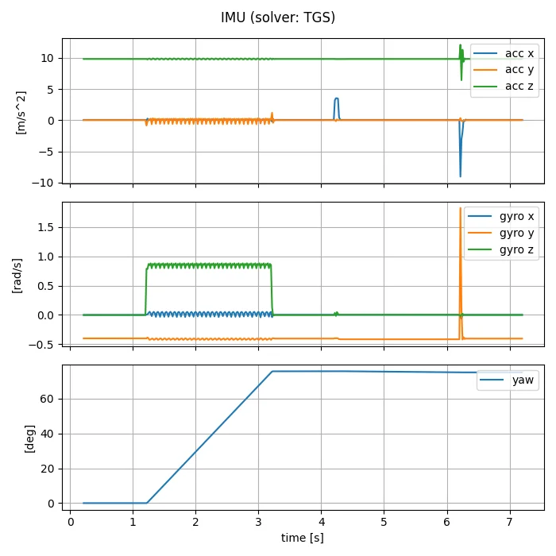
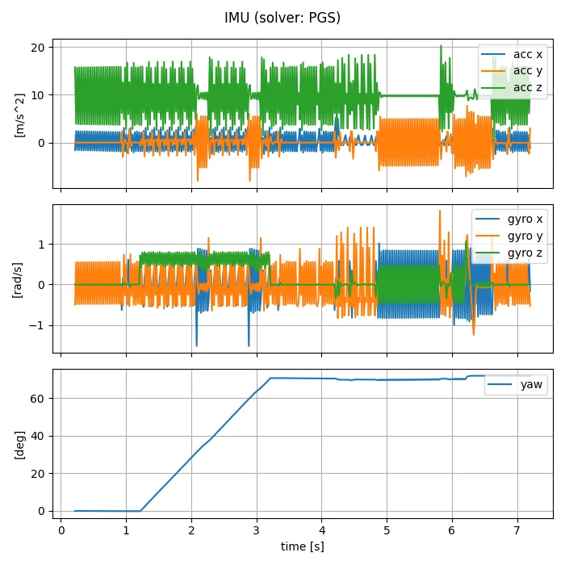
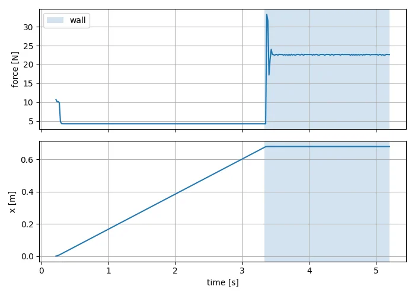
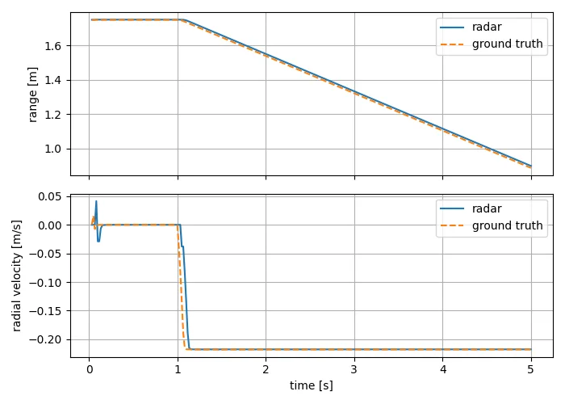

# 付録 D. その他のセンサ

!!! info "この章で学ぶこと"
    Jetbot に IMU・接触センサ・レーダを取り付け、データを取得・保存する

    - **所要時間**: 45 分
    - **前提**: 6 章
    - **対象バージョン**: Isaac Sim 6.1.0

6 章では、カメラと LiDAR を扱いました。Isaac Sim には、ほかにもロボットでよく使うセンサが用意されています。この付録では、6 章と同じように Jetbot に後付けして、次の 3 つを試します。

| センサ | 測るもの | 種類 |
| --- | --- | --- |
| IMU (慣性計測装置) | 加速度・角速度・姿勢 | 物理センサ |
| 接触センサ | 触れたときの力と、触れた相手 | 物理センサ |
| レーダ | 物体までの距離・方向・近づく速さ | RTX センサ |

**物理センサ** は、物理エンジン (PhysX) が計算した物体の動きや力から値を求めます。描画を使わないので軽く、`isaacsim.sensors.experimental.physics` にあります。**RTX センサ** は、6 章のカメラや LiDAR と同じく、GPU の光線追跡 (レイトレーシング) で値を求めます。レーダは `isaacsim.sensors.experimental.rtx` にあります。

この付録のサンプルコードは `examples/appendix_d_sensors/` にあります。

| ファイル | 内容 |
| --- | --- |
| `01_imu.py` | Jetbot に IMU を後付けし、回転・前進したときの値を記録する |
| `02_contact.py` | Jetbot に接触センサを後付けし、壁にぶつかったことを検出する |
| `03_radar.py` | Jetbot にレーダを後付けし、前方の箱までの距離と近づく速さを測る |

どれも公式の standalone_examples (v6.1.0) の `isaacsim.sensors.experimental.physics` と `isaacsim.sensors.experimental.rtx` にあるサンプルをもとにしています。実行方法は 6 章と同じです。記録 (CSV と図) は `--output` で指定した場所に保存されます。

```bash
docker compose -f docker/compose.yml run --rm --no-deps --entrypoint /isaac-sim/python.sh isaac-sim \
  /workspace/examples/appendix_d_sensors/01_imu.py --output /isaac-sim/.local/share/ov/data/output/appendix_d_imu
# 記録はホストの ~/docker/isaac-sim/data/output/appendix_d_imu/ にできる
```

!!! warning "レーダは検証環境ではサポート外の設定で動かしています"
    RTX Radar には Motion BVH という機能が必要ですが、検証環境 (RTX 2080 Ti) では Motion BVH が有効になりませんでした。この付録のレーダの結果は、Motion BVH なしでの実行を強制して得たものです。詳しくは [レーダ](#radar) を参照してください。

## IMU {#imu}

### IMU とは {#what-is-imu}

**IMU** (Inertial Measurement Unit、慣性計測装置) は、加速度と角速度 (回転の速さ) を測るセンサです。スマートフォンの画面の向きの切り替えや、ドローンの姿勢制御などに使われています。移動ロボットでは、車輪の回転から求めた移動量と組み合わせて、自分の位置や向きを推定するのによく使います。

### IMU を作る {#create-imu}

IMU は `IMU.create()` で作り、`IMUSensor` で包んで値を取り出します。LiDAR と同じく、Jetbot の車体 (chassis) の子として作ると、車体と一緒に動きます。IMU は剛体 (物理エンジンで動く物体) の子孫に置く必要があります。

```python
from isaacsim.sensors.experimental.physics import IMU, IMUSensor

# IMU を車体 (chassis) の子として作る。IMU は剛体の子孫に置く必要がある
imu = IMUSensor(IMU.create("/World/Jetbot/chassis/imu"))
```

再生中に `get_data()` を呼ぶと、次の値が辞書で返ってきます。どれも IMU の座標系 (ここでは車体と同じ向き。前が +X、左が +Y、上が +Z) で表されます。

| キー | 内容 |
| --- | --- |
| `time` | シミュレーション時刻 [秒] |
| `linear_acceleration` | 加速度 [m/s²] (x, y, z) |
| `angular_velocity` | 角速度 [rad/s] (x, y, z) |
| `orientation` | 姿勢 (クォータニオン。w, x, y, z の順) |

`01_imu.py` では、Jetbot を「止まる → その場で左に回る → 止まる → 前に進む → 止まる」の順に動かし、毎フレームの値を記録します。

```python
for name, linear, angular, duration in PLAN:
    wheel_actions = controller.forward([linear, angular])
    start_yaw = yaw_deg(imu.get_data()["orientation"])
    integrated = 0.0  # 角速度 (z) を足し合わせた向きの変化 [rad]
    for step in range(round(duration / PHYSICS_DT)):
        jetbot.apply_wheel_actions(wheel_actions)
        simulation_app.update()
        data = imu.get_data()
        acc = np.asarray(data["linear_acceleration"])  # 加速度 [m/s^2] (IMU の座標系)
        gyro = np.asarray(data["angular_velocity"])  # 角速度 [rad/s] (IMU の座標系)
        yaw = yaw_deg(np.asarray(data["orientation"]))
        integrated += gyro[2] * PHYSICS_DT
```

`yaw_deg()` は、クォータニオンから z 軸まわりの向き (ヨー角) を求める関数です。各区間の最後に、姿勢から求めた向きの変化と、角速度の z 成分を足し合わせた (積分した) 値を比べて表示します。本来、この 2 つは同じになるはずです。

### 実行結果 {#imu-output}

検証環境では、次のように表示されました (抜粋)。

```text
[imu] ソルバ: TGS
[imu] t= 0.70 停止   加速度=[ 0.05 -0.    9.81] 角速度=[-0.  -0.4 -0. ] 向き=  -0.0 度
[imu] t= 1.70 左回転  加速度=[ 0.1  -0.57  9.74] 角速度=[-0.03 -0.4   0.8 ] 向き=  18.1 度
[imu] t= 3.20 左回転  加速度=[0.13 0.09 9.85] 角速度=[ 0.05 -0.43  0.85] 向き=  74.9 度
[imu] == 左回転: 向きの変化 74.9 度 / 角速度 (z) を足し合わせた値 97.4 度
[imu] t= 4.70 前進   加速度=[ 0.05 -0.    9.81] 角速度=[ 0.   -0.42  0.  ] 向き=  75.6 度
[imu] == 前進: 向きの変化 -0.6 度 / 角速度 (z) を足し合わせた値 0.4 度
```



まず、止まっているときの加速度の z 成分が約 9.81 m/s² になっています。IMU は重力そのものではなく「重力に逆らって支えられている力」を感じるので、静止していると上向きに重力加速度と同じ大きさの値が出ます。これは実物の IMU と同じ振る舞いです。前進を始めた瞬間 (4.2 秒付近) には x 方向に、止まった瞬間 (6.2 秒付近) には逆向きに大きな値が出ています。

一方で、次の 2 点は実物の IMU とは違います。

- 左に回ると向きは 74.9 度変わったのに、角速度を足し合わせると 97.4 度になる (約 1.3 倍)
- 止まっていても、y 軸まわりの角速度が約 -0.4 rad/s のまま変わらない (実際には車体は傾き続けていない)

### 角速度と向きの変化が合わない {#imu-solver}

この食い違いの原因を調べた結果を書いておきます。

- 物理エンジンが返す車体の角速度 (剛体の速度) も同じ値でした。IMU は物理エンジンの値をそのまま出しており、IMU の計算が間違っているわけではありません
- 車輪に指令を送るのをやめると、y 軸まわりの角速度は約 0.5 秒で 0 に戻りました
- Jetbot のアセットの物理シーンは、ソルバ (物理エンジンの解き方) に **TGS** を使っています。速度の反復回数 (velocity iteration) を 1 から 8 に増やしても、結果はほとんど変わりませんでした

ソルバを **PGS** に変えると、結果が変わります。`01_imu.py` に `--solver PGS` を付けて実行してください。

```text
[imu] ソルバ: PGS
[imu] t= 0.70 停止   加速度=[ 2.26 -0.03  3.75] 角速度=[ 0.    0.56 -0.01] 向き=  -0.1 度
[imu] == 左回転: 向きの変化 70.4 度 / 角速度 (z) を足し合わせた値 71.1 度
```



向きの変化と角速度の積分はほぼ一致しました。ところが今度は、止まっていても加速度と角速度が細かく振動しています。加速度の z 成分は、平均こそ約 9.8 m/s² ですが、標準偏差が約 5.9 m/s² もありました。車体が床の上で小刻みに揺れているためです。PGS でも速度の反復回数を 8 に増やしましたが、振動は収まりませんでした。

つまり、この Jetbot のアセットでは、どちらのソルバでも「実物らしい」IMU の値にはなりませんでした。ここから分かることは次のとおりです。

!!! tip "シミュレータのセンサは、物理エンジンの状態をそのまま映す"
    物理センサの値は、物理エンジンが計算した結果そのものです。ロボットのモデルや物理エンジンの設定によっては、実物のセンサとは違う値が出ることがあります。シミュレータのセンサを使うときは、この付録のように **正解の値** (姿勢や位置など、シミュレータから直接読める値) と比べて、使える値かどうかを確かめましょう。

## 接触センサ {#contact}

### 接触センサとは {#what-is-contact}

**接触センサ** は、物体に触れたことと、そのときの力を測るセンサです。実物では、ロボット掃除機のバンパーや、ロボットハンドの指先の力センサなどにあたります。

### 接触センサを作る {#create-contact}

接触センサは `Contact.create()` で作り、`ContactSensor` で包みます。接触センサも剛体の子孫に置く必要があり、その剛体 (ここでは車体) が何かに触れたときの力を測ります。

```python
from isaacsim.sensors.experimental.physics import Contact, ContactSensor

contact = ContactSensor(Contact.create("/World/Jetbot/chassis/contact_sensor"))
contact.add_raw_contact_data_to_frame()  # 接触の一つひとつ (相手・位置など) も取得する
```

`get_data()` で返ってくる主な値は次のとおりです。`contacts` は、`add_raw_contact_data_to_frame()` を呼んだときだけ中身が入ります。

| キー | 内容 |
| --- | --- |
| `in_contact` | 何かに触れているか (True / False) |
| `force` | 触れている力の合計 [N] |
| `number_of_contacts` | 接触点の数 |
| `contacts` | 接触点ごとの情報のリスト。`body0` と `body1` (触れている 2 つの物体のパス)、`position` (位置)、`normal` (向き)、`impulse` (力積) など |

### 床との接触と、壁との接触を見分ける {#contact-filter}

`02_contact.py` では、前方 0.8 m に壁を置き、Jetbot を 0.2 m/s で走らせてぶつけます。

ここで気を付けることがあります。Jetbot の車体は、キャスタ (前後の小さな球) で **常に床に触れています**。そのため `in_contact` はずっと True になり、それだけでは壁にぶつかったかどうか分かりません。そこで、接触点ごとの相手 (`body1`) を調べ、床 (`GroundPlane`) 以外との接触を探します。

```python
data = contact.get_data()
# 床 (GroundPlane) 以外との接触だけを取り出す
others = [c for c in data["contacts"] if "GroundPlane" not in c["body1"]]
```

### 実行結果 {#contact-output}

検証環境では、次のように表示されました (抜粋)。

```text
[contact] t=0.70 x=0.101 m 接触中=True 力= 4.28 N 接触点= 6 (床以外 0)
[contact] t=3.20 x=0.646 m 接触中=True 力= 4.28 N 接触点= 6 (床以外 0)
[contact] t=3.33 床以外と接触しました: ['/World/Wall']
[contact]   接触位置の例: [ 0.742 -0.01   0.098]
[contact] t=3.70 x=0.679 m 接触中=True 力=22.68 N 接触点=10 (床以外 4)
```



走っている間は、床から受ける約 4.3 N の力だけが出ています。3.33 秒に壁 (`/World/Wall`) との接触が現れ、力が約 22.7 N に増えました。Jetbot は x = 0.679 m で止まりました。車輪には前進の指令を送り続けているので、その後も壁を押し続けます。接触位置の x (0.742 m) は、壁の手前の面 (x = 0.75 m) とほぼ一致します。

## レーダ {#radar}

### レーダとは {#what-is-radar}

**レーダ** は、電波を出して、物体に当たって返ってきた電波から距離と方向を測るセンサです。返ってきた電波の周波数のずれ (ドップラー効果) から、物体が近づく (遠ざかる) 速さも分かります。LiDAR より細かい形は分かりませんが、雨や霧に強いので、自動車の衝突防止などに使われています。

### Motion BVH が必要 {#motion-bvh}

RTX Radar は、ドップラー効果を正しく計算するために **Motion BVH** (動きを含めて光線追跡を行う仕組み) を必要とします。スタンドアロンスクリプトでは、`SimulationApp` に `enable_motion_bvh=True` を渡して有効にします。

```python
simulation_app = SimulationApp({"headless": True, "enable_motion_bvh": True})
```

ところが検証環境 (RTX 2080 Ti) では、これを指定しても Motion BVH が有効にならず、レーダを作った時点で次のエラーが出て止まりました。公式のサンプル `inspect_radar_gmo.py` をそのまま実行しても同じでした。

```text
[Warning] [rtx.sensors.radar.dmatapprox.plugin] MotionBVH activation state 0 doesn't match requested state 1
[Fatal] [rtx.sensors.radar.dmatapprox.plugin] Running radar without MotionBVH is disallowed, to force it use --/app/sensors/nv/radar/runWithoutMBVH=true
```

エラーの中にあるとおり、`--/app/sensors/nv/radar/runWithoutMBVH=true` を付けると、Motion BVH なしで実行を続けられます。`03_radar.py` では、`--without-motion-bvh` を付けたときにこの設定を加えるようにしています。

```bash
docker compose -f docker/compose.yml run --rm --no-deps --entrypoint /isaac-sim/python.sh isaac-sim \
  /workspace/examples/appendix_d_sensors/03_radar.py --without-motion-bvh \
  --output /isaac-sim/.local/share/ov/data/output/appendix_d_radar
```

!!! warning "Motion BVH なしの実行はサポート外です"
    公式ドキュメントには、Motion BVH なしでは RTX Radar は正確な結果を出さないと書かれています。この付録の単純な場面 (止まっている箱に、レーダを載せた Jetbot が近づく) では正解とよく一致しましたが、ほかの場面でも正しい保証はありません。Motion BVH が有効になる GPU では、`--without-motion-bvh` を付けずに実行してください (検証環境では試せていません)。

### レーダを作る {#create-radar}

レーダは `Radar()` で作り、`RadarSensor` で包みます。測定結果は LiDAR と同じく `generic-model-output` で取り出します。

```python
from isaacsim.sensors.experimental.rtx import Radar, RadarSensor, parse_generic_model_output_data

# レーダを車体 (chassis) の子として作る。前方 (+X) を向く
#   aux_output_level="BASIC": 相対速度 (rv_ms) などの追加の値も出力する
radar = Radar(
    "/World/Jetbot/chassis/radar",
    translations=[0.0, 0.0, 0.12],  # 車体の上 12 cm に取り付ける
    aux_output_level="BASIC",
)
sensor = RadarSensor(radar, annotators=["generic-model-output"])
```

取り出し方も 6 章の LiDAR とほぼ同じです。球座標で、`x` が方位角 [度]、`y` が仰角 [度]、`z` が距離 [m] です。`aux_output_level="BASIC"` を指定すると、相対速度 `rv_ms` [m/s] (近づくときは負) も得られます。

```python
data, _ = sensor.get_data("generic-model-output")
gmo = parse_generic_model_output_data(data)
n = gmo.numElements
ranges = np.asarray(gmo.z)[:n]
i = int(np.argmin(ranges))  # 一番近い検出を使う
azimuth, rng, rv = float(gmo.x[i]), float(ranges[i]), float(gmo.rv_ms[i])
```

LiDAR が多くの点を返すのに対して、レーダの検出は少数の点です。この場面では、毎フレーム 1 個でした。

### 実行結果 {#radar-output}

`03_radar.py` は、前方 2.0 m に一辺 0.5 m の箱を置き (Jetbot 側の面は x = 1.75 m)、1 秒止まったあと 0.2 m/s で 4 秒進みます。正解 (箱の面までの距離と、Jetbot の位置の変化から求めた速さ) と並べて表示します。

```text
[radar] 停止 検出数=1 距離=1.75 m (正解 1.75 m) 方位角=-0.21 度 相対速度= 0.000 m/s (正解  0.000 m/s)
[radar] 前進 検出数=1 距離=1.66 m (正解 1.65 m) 方位角= 0.32 度 相対速度=-0.218 m/s (正解 -0.218 m/s)
[radar] 前進 検出数=1 距離=1.33 m (正解 1.32 m) 方位角= 0.64 度 相対速度=-0.218 m/s (正解 -0.218 m/s)
[radar] 前進 検出数=1 距離=0.90 m (正解 0.89 m) 方位角= 1.60 度 相対速度=-0.218 m/s (正解 -0.218 m/s)
```



距離は正解との差が 0.01〜0.02 m、相対速度は正解と同じ -0.218 m/s になりました。動き始めのところで、レーダの値が正解より数フレーム遅れて変わっています。

!!! note "検証環境では、正面の物体しか検出されませんでした"
    箱を斜め前 (`positions=[2.0, 0.5, 0.25]`、方位角は約 7〜20 度) に移すと、箱は検出されず、距離 100 m・`scalar` -60 の点が 1 個だけ返りました。正面の箱に加えて斜め前にもう 1 つ箱を置いた場合も、検出されたのは正面の箱だけでした。レーダの方位角の範囲 (`maxAzAngDeg`) は ±66 度なので、本来は斜め前の箱も検出されるはずです。Motion BVH なしで動かしている影響かどうかは、検証環境では確かめられていません。

## 必要な GPU メモリ {#vram}

検証環境 (VRAM 11GB) で、各サンプルを実行している間の GPU メモリの使用量 (`nvidia-smi` で測った GPU 全体の値。何も動かしていないときは約 0.7GB) の最大値は次のとおりでした。どれも 11GB に収まります。

| サンプル | GPU メモリの使用量 (最大) |
| --- | --- |
| `01_imu.py` | 約 2.4GB |
| `02_contact.py` | 約 2.4GB |
| `03_radar.py --without-motion-bvh` | 約 6.9GB |

## まとめ {#summary}

- 物理センサ (IMU・接触センサ) は物理エンジンの計算結果から値を求め、RTX センサ (レーダなど) は光線追跡で値を求める
- IMU は `IMU.create()`、接触センサは `Contact.create()` で作る。どちらも剛体 (ここでは車体) の子孫に置く
- IMU の加速度には重力の分 (静止時に z が約 9.81 m/s²) が含まれる
- この Jetbot のアセットでは、IMU の角速度が向きの変化と合わなかった。シミュレータのセンサの値は、正解と比べて確かめる
- 車体はいつも床に触れているので、接触センサで衝突を検出するには、接触点ごとの相手 (`body1`) を見る
- レーダは `Radar()` で作り、`generic-model-output` から距離・方位角・相対速度 (`rv_ms`) を読む。Motion BVH が必要で、検証環境 (RTX 2080 Ti) ではサポート外の設定で動かした (正面の物体しか検出されなかった)

## 演習 {#exercises}

1. `01_imu.py` の `PLAN` で、前進の速さを 0.2 から 0.4 m/s に変えてください。前進を始めた瞬間の x 方向の加速度がどう変わるかを、`imu.csv` や `imu.png` で確かめてください。
2. `02_contact.py` で、壁の手前に箱を置いて、壁より先に箱にぶつかるようにしてください。表示される接触相手が変わることを確かめてください (ヒント: 箱にも `UsdPhysics.CollisionAPI` を付けます)。
3. `03_radar.py` の `BOX_FACE_X` を 3.75 に変えて箱を遠くに置き、距離と相対速度が正しく測れることを確かめてください。

## 参考リンク {#references}

- [Sensors (Isaac Sim ドキュメント)](https://docs.isaacsim.omniverse.nvidia.com/6.1.0/sensors/index.html)
- [Physics-based sensors (Isaac Sim ドキュメント)](https://docs.isaacsim.omniverse.nvidia.com/6.1.0/sensors/isaacsim_sensors_physics.html)
- [IMU sensor (Isaac Sim ドキュメント)](https://docs.isaacsim.omniverse.nvidia.com/6.1.0/sensors/isaacsim_sensors_physics_imu.html)
- [Contact sensor (Isaac Sim ドキュメント)](https://docs.isaacsim.omniverse.nvidia.com/6.1.0/sensors/isaacsim_sensors_physics_contact.html)
- [RTX Radar Sensor (Isaac Sim ドキュメント)](https://docs.isaacsim.omniverse.nvidia.com/6.1.0/sensors/isaacsim_sensors_rtx_radar.html)
- [isaacsim.sensors.experimental.physics API (Isaac Sim ドキュメント)](https://docs.isaacsim.omniverse.nvidia.com/6.1.0/py/source/extensions/isaacsim.sensors.experimental.physics/docs/index.html)
- [imu_sensor.py (standalone_examples v6.1.0、GitHub)](https://github.com/isaac-sim/IsaacSim/blob/v6.1.0/source/standalone_examples/api/isaacsim.sensors.experimental.physics/imu_sensor.py)
- [contact_sensor.py (standalone_examples v6.1.0、GitHub)](https://github.com/isaac-sim/IsaacSim/blob/v6.1.0/source/standalone_examples/api/isaacsim.sensors.experimental.physics/contact_sensor.py)
- [inspect_radar_gmo.py (standalone_examples v6.1.0、GitHub)](https://github.com/isaac-sim/IsaacSim/blob/v6.1.0/source/standalone_examples/api/isaacsim.sensors.experimental.rtx/inspect_radar_gmo.py)
