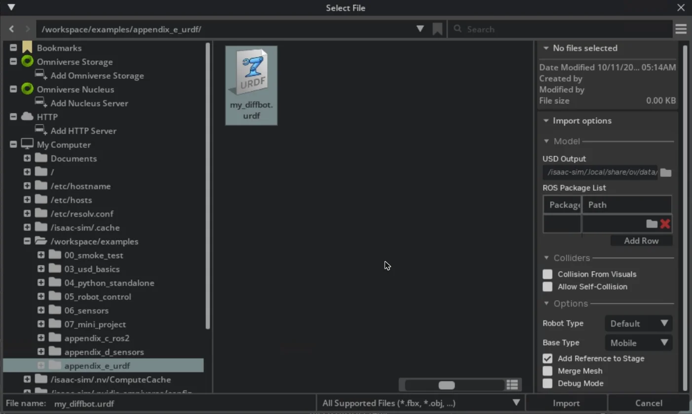
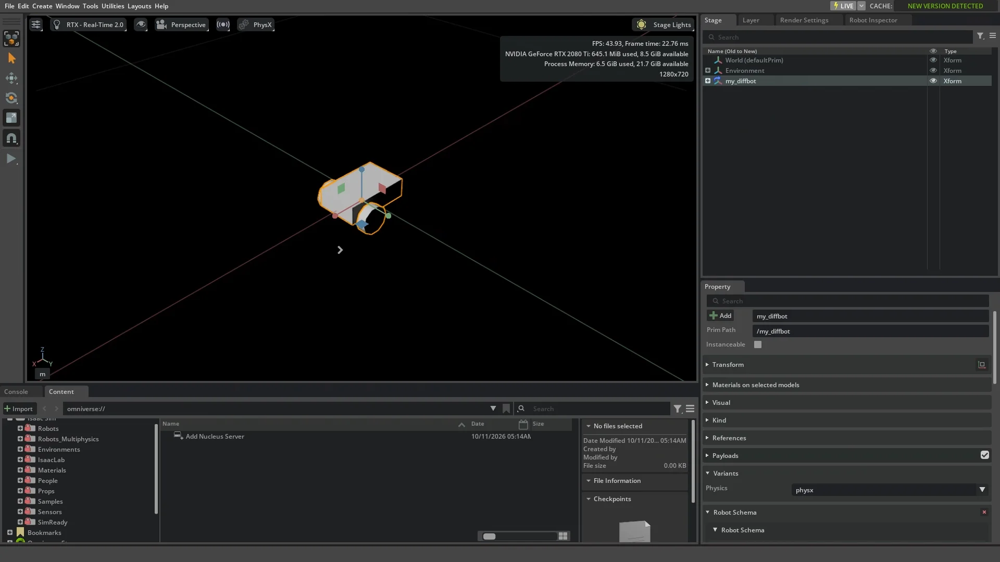

# 付録 E. 自作ロボットの取り込み (URDF)

!!! info "この章で学ぶこと"
    URDF で書いた自作ロボットを USD に変換し、関節・コリジョン・質量を確かめて調整し、5 章と同じ方法で走らせる

    - **所要時間**: 45 分
    - **前提**: 5 章
    - **対象バージョン**: Isaac Sim 6.1.0

本編では、Isaac Sim に用意されている Jetbot のアセット (USD) を使ってきました。自分で設計したロボットや、ROS のパッケージで配布されているロボットを使いたいときは、そのロボットを Isaac Sim に取り込む必要があります。

ロボットの形や関節は、**URDF** (Unified Robot Description Format) という XML のファイルで書かれていることがよくあります。ROS で広く使われている形式です。Isaac Sim は URDF を直接は読めないので、**URDF Importer** で USD に変換してから使います。この付録では、次の流れを試します。

1. Jetbot に近い大きさの差動二輪ロボットを URDF で書く
2. URDF Importer で USD に変換する (GUI と Python)
3. 変換した USD の関節・コリジョン・質量を確かめ、足りない設定を補う
4. 5 章と同じコントローラで走らせ、Jetbot と比べる

この付録のサンプルコードは `examples/appendix_e_urdf/` にあります。

| ファイル | 内容 |
| --- | --- |
| `my_diffbot.urdf` | 題材にする差動二輪ロボットの URDF |
| `01_import_urdf.py` | URDF を Python で USD に変換する |
| `02_inspect_robot.py` | 変換した USD のリンク・コリジョン・質量・関節を表示する |
| `03_drive_my_robot.py` | 変換したロボットを 5 章と同じ手順で走らせる |

`01_import_urdf.py` は公式の standalone_examples (v6.1.0) の `isaacsim.asset.importer.urdf/urdf_import.py` を、`03_drive_my_robot.py` は 5 章の `02_drive_jetbot.py` をもとにしています。実行方法は 5 章と同じです。

```bash
docker compose -f docker/compose.yml run --rm --no-deps --entrypoint /isaac-sim/python.sh isaac-sim \
  /workspace/examples/appendix_e_urdf/01_import_urdf.py
```

!!! note "Robot Setup の全体像"
    公式ドキュメントでは、ロボットを取り込んで使えるようにするまでの作業をまとめて **Robot Setup** と呼んでいます。URDF のほかに MJCF (MuJoCo の形式) の取り込み、CAD データからの組み立て、関節の駆動の強さ (ゲイン) の調整などが含まれます。この付録では、そのうち URDF の取り込みと、走らせるのに最低限必要な調整だけを扱います。

## 題材: 自作の差動二輪ロボット {#my-diffbot}

題材には、Jetbot とほぼ同じ大きさの差動二輪ロボット `my_diffbot` を使います。メッシュ (3D モデルのファイル) を使わず、箱・円柱・球だけで作っているので、URDF のファイル 1 つで完結します。

| リンク | 形 | 大きさ | 質量 |
| --- | --- | --- | --- |
| `base_link` (車体) | 箱 | 0.14 × 0.09 × 0.04 m | 0.5 kg |
| `left_wheel` / `right_wheel` (車輪) | 円柱 | 半径 0.03 m、幅 0.02 m | 0.05 kg |
| `caster` (補助輪) | 球 | 半径 0.015 m | 0.01 kg |

車輪の半径 (0.03 m) と左右の車輪の間隔 (0.1125 m) は Jetbot と同じにしてあります。こうしておくと、5 章の差動二輪のコントローラを同じ値のまま使えます。

URDF は、**リンク** (`<link>`、部品) と **関節** (`<joint>`、部品のつなぎ方) を並べて書きます。たとえば左の車輪は次のように書いています。

```xml
<link name="left_wheel">
  <visual>       <!-- 見た目の形 -->
    <origin xyz="0 0 0" rpy="1.5708 0 0"/>   <!-- 円柱を x 軸まわりに 90 度倒して、軸を y 方向にする -->
    <geometry><cylinder radius="0.03" length="0.02"/></geometry>
  </visual>
  <collision>    <!-- 衝突判定の形 (ここでは見た目と同じ) -->
    <origin xyz="0 0 0" rpy="1.5708 0 0"/>
    <geometry><cylinder radius="0.03" length="0.02"/></geometry>
  </collision>
  <inertial>     <!-- 質量と慣性モーメント -->
    <mass value="0.05"/>
    <inertia ixx="0.000013" ixy="0" ixz="0" iyy="0.000023" iyz="0" izz="0.000013"/>
  </inertial>
</link>

<!-- 車体と左の車輪を、y 軸まわりに回り続けられる関節 (continuous) でつなぐ -->
<joint name="left_wheel_joint" type="continuous">
  <parent link="base_link"/>
  <child link="left_wheel"/>
  <origin xyz="0.03 0.05625 0" rpy="0 0 0"/>   <!-- 車体の原点から見た関節の位置 -->
  <axis xyz="0 1 0"/>
  <limit effort="1.0" velocity="20.0"/>        <!-- 最大トルク [N·m] と最大速度 [rad/s] -->
</joint>
```

補助輪は、車体に固定する関節 (`type="fixed"`) でつないでいます。ファイル全体は `examples/appendix_e_urdf/my_diffbot.urdf` を見てください。

!!! tip "URDF の 3 つの形"
    1 つのリンクに、見た目の形 (`<visual>`)・衝突判定の形 (`<collision>`)・質量 (`<inertial>`) を別々に書きます。実際のロボットの URDF では、見た目は細かいメッシュ、衝突判定は単純な形 (箱や円柱) にすることがよくあります。衝突判定の形が単純なほど、物理の計算が速く安定します。

## GUI で取り込む {#import-gui}

まず GUI で取り込んでみます。1 章の手順で Isaac Sim を起動し、ブラウザで `http://localhost:8210` を開いておいてください。

1. メニューの `File > Import` を選ぶ。「Select File」のダイアログが開く
2. 左のツリーで `/workspace/examples` → `appendix_e_urdf` を開き、`my_diffbot.urdf` を選ぶ。右側に変換の設定 (Import options) が表示される
3. `USD Output` の右のフォルダのボタンで、保存先に `/isaac-sim/.local/share/ov/data` を選ぶ
4. `Base Type` を `Mobile` にする
5. `Import` を押す



設定の項目は次のとおりです。多くは、次に説明する Python の `URDFImporterConfig` の設定と対応しています。

| 項目 | 意味 | Python の設定 |
| --- | --- | --- |
| `USD Output` | 変換した USD の保存先。既定は URDF と同じフォルダ | `usd_path` |
| `ROS Package List` | URDF の中の `package://` のパスを、実際のフォルダに対応づける | — |
| `Collision From Visuals` | 見た目の形から衝突判定の形を作る | `collision_from_visuals` |
| `Allow Self-Collision` | ロボットの部品どうしの衝突を判定する | `allow_self_collision` |
| `Base Type` | `Source` (URDF のまま)・`Fixed` (土台を床に固定)・`Mobile` (固定しない) | `fix_base` |
| `Add Reference to Stage` | 変換した USD を、いまのステージに読み込む | — |

`examples/` はコンテナに読み取り専用でマウントしているので、`USD Output` には書き込める場所を指定します。手順 3 のように `/isaac-sim/.local/share/ov/data` (ホストの `~/docker/isaac-sim/data`) を選ぶと、その下に `my_diffbot/` のフォルダができ、`my_diffbot.usda` などが保存されます。

`Add Reference to Stage` にチェックが入っていると、変換が終わったあと、ステージの直下に `/my_diffbot` ができます (`/World` の下ではありません)。Stage パネルで `/my_diffbot` を選び、マウスをビューポートに置いて `F` キーを押すと、ロボットが画面の中央に表示されます。Property パネルの `Variants` を見ると、物理の設定 (`Physics`) に `physx` が選ばれています (variant については [変換した USD の構成](#usd-structure) で説明します)。



!!! warning "GUI のダイアログには関節の駆動の設定がない"
    検証環境 (Isaac Sim 6.1.0) の `File > Import` のダイアログには、関節の駆動 (Python の `joint_target_type` や `override_joint_damping`) を指定する項目がありませんでした。取り込むと、画面下に「Stiffness and damping not available joint /my_diffbot/Physics/right_wheel_joint, actuator will be created without gain parameters」という警告が表示され、変換した USD の車輪の関節には、駆動の強さ (damping) が入っていませんでした。この状態では、[あとで説明する](#default-settings) ように、車輪に速度を指令しても回りません。走らせるには、取り込んだあとで関節の駆動を設定するか、次の Python で取り込みます。

この付録では、以降は Python で取り込みます。Python なら駆動も含めて設定でき、同じ設定で何度でも変換し直せるので、URDF を直しながら試すときにも便利です。

## Python で取り込む {#import-python}

Python では、`isaacsim.asset.importer.urdf` の `URDFImporterConfig` に設定を書き、`URDFImporter` で変換します。`01_import_urdf.py` の中心は次の部分です。

```python
from isaacsim.asset.importer.urdf import URDFImporter, URDFImporterConfig

config = URDFImporterConfig(urdf_path=args.urdf, usd_path=args.output)
config.fix_base = False  # 床に固定しない (車輪で走るロボットなので)
config.joint_target_type = "velocity"  # 関節を速度で動かす
config.override_joint_damping = 10000.0  # 速度の駆動の強さ [N·m·s/rad] (Jetbot と同じ値)

usd_path = URDFImporter(config).import_urdf()
```

`import_urdf()` は、変換した USD のパスを返します。実行すると、次のように表示されます。

```text
[import_urdf] 変換しました: /isaac-sim/.local/share/ov/data/output/appendix_e_urdf/my_diffbot/my_diffbot.usda
[import_urdf]   my_diffbot.usda
[import_urdf]   payloads/Physics/mujoco.usda
[import_urdf]   payloads/Physics/physics.usda
[import_urdf]   payloads/Physics/physx.usda
[import_urdf]   payloads/base.usda
[import_urdf]   payloads/robot.usda
```

`usd_path` に指定したフォルダの下に、ロボットの名前のフォルダ (`my_diffbot/`) ができ、その中に USD が保存されます。保存先はコンテナを消しても残るように、`~/docker/isaac-sim/data` (コンテナ内の `/isaac-sim/.local/share/ov/data`) の下にしています。ホストでは `~/docker/isaac-sim/data/output/appendix_e_urdf/my_diffbot/` にできます。

!!! warning "保存先には書き込める場所を指定する"
    `usd_path` の既定値は、URDF と同じフォルダです。`examples/` はコンテナに読み取り専用でマウントしているので、書き込める場所を `usd_path` に指定してください。また、保存先に同じ名前のフォルダがすでにあると、`my_diffbot_1` のような別の名前で保存されます。`01_import_urdf.py` では、前回の出力を消してから変換しています。

主な設定は次のとおりです。ほかの設定は [URDF Importer Extension](https://docs.isaacsim.omniverse.nvidia.com/6.1.0/importer_exporter/ext_isaacsim_asset_importer_urdf.html) を参照してください。

| 設定 | 既定値 | 意味 |
| --- | --- | --- |
| `fix_base` | `None` (URDF のまま) | `True` で土台を床に固定、`False` で固定しない |
| `joint_target_type` | `None` (変えない) | 関節の駆動の目標: `"position"` (角度)・`"velocity"` (速度)・`"none"` |
| `override_joint_stiffness` | `None` (変えない) | 角度を目標に近づける強さ。速度で動かすときは 0 |
| `override_joint_damping` | `None` (変えない) | 速度を目標に近づける強さ |
| `link_density` | `None` | 質量が書かれていないリンクに使う密度 [kg/m³] |
| `merge_fixed_joints` | `False` | 固定の関節でつながったリンクを 1 つにまとめる |
| `collision_from_visuals` | `False` | 見た目の形から衝突判定の形を作る |
| `allow_self_collision` | `False` | ロボットの部品どうしの衝突を判定する |

### 変換した USD の構成 {#usd-structure}

変換した USD は、1 つのファイルではなく、役割ごとに分かれています。

| ファイル | 中身 |
| --- | --- |
| `my_diffbot.usda` | 入り口のファイル。下のファイルを読み込む |
| `payloads/base.usda` | 見た目と衝突判定の形 |
| `payloads/robot.usda` | ロボットとしての情報 (どれがリンクで、どれが関節か) |
| `payloads/Physics/physics.usda` | 質量・関節・駆動など、物理の設定 |
| `payloads/Physics/physx.usda` | `physics.usda` に PhysX 用の設定を足したもの |
| `payloads/Physics/mujoco.usda` | `physics.usda` に MuJoCo 用の設定を足したもの |

物理の設定は、**variant** (バリアント) という仕組みで切り替えられるようになっています。`my_diffbot.usda` には `Physics` という variant があり、`physx`・`physics`・`mujoco`・`none` から選びます。**変換した直後の USD では、どれも選ばれていません**。選ばずに読み込むと、物理の設定がない (形だけの) ロボットになります。Jetbot のアセット (`Robots_Multiphysics/NVIDIA/Jetbot/jetbot.usda`) は `physx` を選んであるので、この付録でも `physx` を選んで読み込みます。

```python
stage_utils.add_reference_to_stage(usd_path, "/World/MyBot", variants=[("Physics", "physx")])
```

!!! warning "WheeledRobot の usd_path では variant を選べない"
    5 章では、`WheeledRobot(..., usd_path=...)` でアセットの読み込みとロボットの作成を一度に行いました。この方法では variant を選べないので、変換した USD をそのまま渡すと、物理の設定がないまま読み込まれます。検証環境では、関節を持つロボット (Articulation) が見つからず、`Path.IsValidPathString(NoneType)` というエラーで止まりました。先に `add_reference_to_stage()` で variant を選んで読み込み、その Prim を `WheeledRobot` に渡してください (`usd_path` は指定しません)。

## 取り込んだ結果を確かめる {#inspect}

変換した USD が URDF のとおりになっているかを、`02_inspect_robot.py` で確かめます。

```bash
docker compose -f docker/compose.yml run --rm --no-deps --entrypoint /isaac-sim/python.sh isaac-sim \
  /workspace/examples/appendix_e_urdf/02_inspect_robot.py
```

```text
variant Physics: ['mujoco', 'none', 'physics', 'physx'] のうち 'physx' を選択

== リンク (剛体) と質量
/World/MyBot/Geometry/base_link  質量 = 0.5 kg
/World/MyBot/Geometry/base_link/left_wheel  質量 = 0.05000000074505806 kg
/World/MyBot/Geometry/base_link/right_wheel  質量 = 0.05000000074505806 kg
/World/MyBot/Geometry/base_link/caster  質量 = 0.009999999776482582 kg

== コリジョン (衝突判定の形)
/World/MyBot/Geometry/base_link/left_wheel/cylinder_1  Cylinder  半径 0.03 m、長さ 0.02 m
/World/MyBot/Geometry/base_link/right_wheel/cylinder_1  Cylinder  半径 0.03 m、長さ 0.02 m
/World/MyBot/Geometry/base_link/caster/sphere_1  Sphere  半径 0.015 m
/World/MyBot/Geometry/base_link/box_1  Cube

== 関節
left_wheel_joint  PhysicsRevoluteJoint  base_link → left_wheel  回転軸 = Y
    駆動: stiffness = 0.0, damping = 174.53292846679688, maxForce = 1.0
right_wheel_joint  PhysicsRevoluteJoint  base_link → right_wheel  回転軸 = Y
    駆動: stiffness = 0.0, damping = 174.53292846679688, maxForce = 1.0
caster_joint  PhysicsFixedJoint  base_link → caster
```

URDF と見比べると、次のことがわかります。

- **質量**: URDF の `<mass>` の値がそのまま入っている (0.05000000074505806 のような端数は、32 ビットの浮動小数点数で保存されているため)
- **コリジョン**: URDF の `<collision>` の形と大きさが、そのまま USD の `Cylinder` や `Sphere` になっている。見た目の形は、同じリンクの下に別の Prim (`cylinder` など、`_1` が付かないほう) としてできる
- **関節**: `continuous` の関節は回転関節 (`PhysicsRevoluteJoint`)、`fixed` の関節は固定関節 (`PhysicsFixedJoint`) になっている。URDF の `effort` (1.0) は、駆動の最大の力 (`maxForce`) になっている
- **駆動の強さ**: 指定した 10000 N·m·s/rad が、174.53 になっている。USD では回転関節の駆動の強さを「度」あたりで保存するため (10000 × π / 180 ≈ 174.53)。Jetbot のアセットの車輪の関節も、同じ 174.53 になっている

### 既定の設定のままだと動かない {#default-settings}

`01_import_urdf.py --default` で、設定を変えずに変換すると、`02_inspect_robot.py` の表示は次のように変わります。

```text
== 関節
root_joint  PhysicsFixedJoint  MyBot → base_link
left_wheel_joint  PhysicsRevoluteJoint  base_link → left_wheel  回転軸 = Y
    駆動: stiffness = 0.0, damping = 0.0, maxForce = 1.0
...
```

- **`root_joint` ができる**: 車体を床 (ワールド) に固定する関節です。アームのように土台を固定して使うロボットには便利ですが、走るロボットは動けなくなります。`fix_base=False` にすると作られません
- **駆動の強さが 0**: URDF には駆動の強さを書く場所がないため、0 のままになります。0 のままだと、目標の速度を指令しても車輪に力がかかりません。`joint_target_type="velocity"` と `override_joint_damping` で設定します

検証環境で、0.2 m/s で 2 秒進むように指令して比べた結果は次のとおりです。

| 変換の設定 | 2 秒後の位置 x | 車輪の角速度 (目標 6.67 rad/s) |
| --- | --- | --- |
| 既定のまま | 0 m (動かない) | 77.03 と -6.09 rad/s (指令と関係なく回る) |
| `fix_base=False` だけ | 0 m (動かない) | 0.005 と -0.001 rad/s (回らない) |
| `fix_base=False` + 駆動の設定 | 0.361 m | 6.49 と 6.48 rad/s |

既定のままの車輪が指令と関係なく回っているのは、車体が原点に固定され、車輪が床にめり込んで押し出されているためと思われます。

## 走らせる {#drive}

`03_drive_my_robot.py` で、5 章の `02_drive_jetbot.py` と同じ「直進 3 秒 → 左に 90 度旋回 → 直進 3 秒 → 停止」を走らせます。違いは、ロボットの読み込み方 (variant を選ぶ) と、次に説明する補助輪の摩擦の設定だけです。

```bash
docker compose -f docker/compose.yml run --rm --no-deps --entrypoint /isaac-sim/python.sh isaac-sim \
  /workspace/examples/appendix_e_urdf/03_drive_my_robot.py
```

```text
[drive_my_robot] 補助輪に摩擦 0 の物理マテリアルを割り当てました
スタート           x = -0.000 m  y =  0.000 m  向き =    -0.0 度
--- 直進: 左右の車輪の角速度 = [6.67 6.67] rad/s
直進 の後          x =  0.591 m  y = -0.014 m  向き =    -1.9 度
               車輪の角速度 (実際) = [6.66 6.67] rad/s
--- 左に 90 度旋回: 左右の車輪の角速度 = [-1.47  1.47] rad/s
左に 90 度旋回 の後   x =  0.615 m  y = -0.044 m  向き =    71.9 度
               車輪の角速度 (実際) = [-1.41  1.42] rad/s
--- 直進: 左右の車輪の角速度 = [6.67 6.67] rad/s
直進 の後          x =  0.770 m  y =  0.526 m  向き =    74.6 度
               車輪の角速度 (実際) = [6.66 6.67] rad/s
--- 停止: 左右の車輪の角速度 = [0. 0.] rad/s
停止 の後          x =  0.771 m  y =  0.529 m  向き =    75.1 度
               車輪の角速度 (実際) = [-0.02  0.01] rad/s
```

5 章の Jetbot とほぼ同じように走りました。旋回で向きが変わったのは 73.8 度 (-1.9 度 → 71.9 度) で、指令の 90 度より足りないところも、Jetbot (74.0 度) と同じです。

### 補助輪の摩擦を調整する {#caster-friction}

URDF には、摩擦の情報を書く場所がありません。そのため、変換した USD では、補助輪にも床と同じように摩擦がかかります。実物の補助輪は転がって向きを変えるので、ほとんど抵抗になりませんが、シミュレーションでは球が床を引きずられ、ブレーキになってしまいます。

Jetbot のアセットを調べると、補助輪には摩擦 0 の物理マテリアル (`caster_material`) が割り当ててあり、摩擦の組み合わせ方 (`frictionCombineMode`) が `min` になっていました。`03_drive_my_robot.py` でも同じ設定をしています。

```python
material = UsdShade.Material.Define(stage, "/World/Physics/CasterMaterial")
material_api = UsdPhysics.MaterialAPI.Apply(material.GetPrim())
material_api.CreateStaticFrictionAttr(0.0)  # 静止摩擦係数
material_api.CreateDynamicFrictionAttr(0.0)  # 動摩擦係数
# 摩擦は接している 2 つの物の値を組み合わせて決まる (既定は平均)。
# "min" にすると小さいほう (ここでは 0) が使われる
PhysxSchema.PhysxMaterialAPI.Apply(material.GetPrim()).CreateFrictionCombineModeAttr("min")
caster_collision = stage.GetPrimAtPath("/World/MyBot/Geometry/base_link/caster/sphere_1")
UsdShade.MaterialBindingAPI.Apply(caster_collision).Bind(
    material, UsdShade.Tokens.weakerThanDescendants, "physics"
)
```

`--no-caster-material` を付けると、この設定をせずに走らせて比べられます。

| 補助輪の摩擦 | 最初の直進の後の x | 旋回で変わった向き | 旋回中の車輪の角速度 (目標 ±1.47 rad/s) |
| --- | --- | --- | --- |
| 調整なし (`--no-caster-material`) | 0.550 m | 47.1 度 | -1.29 と 1.19 rad/s |
| 摩擦 0、組み合わせ方 `min` | 0.591 m | 73.8 度 | -1.41 と 1.42 rad/s |

調整しないと、旋回は指令の半分ほどしか回りませんでした。

!!! tip "摩擦の組み合わせ方に注意"
    検証の途中で、摩擦を 0 にしただけで組み合わせ方を既定 (平均) のままにしたところ、旋回で変わった向きは約 60 度でした。床の摩擦との平均になり、摩擦が 0 にならないためです。物理マテリアルを設定したら、組み合わせ方も確かめてください。

## まとめ {#summary}

- URDF は、リンク (見た目・衝突判定・質量) と関節を XML で書いたファイル。Isaac Sim では URDF Importer で USD に変換して使う
- Python では `URDFImporterConfig` に設定を書き、`URDFImporter(config).import_urdf()` で変換する。保存先 (`usd_path`) は書き込める場所を指定する
- 既定の設定では、土台が床に固定され (`root_joint`)、関節の駆動の強さが 0 になる。走るロボットでは `fix_base=False` と、駆動の設定 (`joint_target_type`・`override_joint_damping`) が必要
- 変換した USD は物理の設定を variant (`Physics`) で切り替える。読み込むときに `physx` などを選ぶ
- 質量・コリジョン・関節は URDF のとおりに変換されるが、摩擦は URDF に書けない。補助輪のように摩擦が邪魔になる部品には、物理マテリアルを割り当てる
- 変換したロボットも、5 章と同じ `WheeledRobot` と `DifferentialController` で走らせられる

## 演習 {#exercises}

1. `my_diffbot.urdf` の `base_link` の質量 (`<mass value="0.5"/>`) を 2.0 に変えて変換し直してください。`02_inspect_robot.py` で質量が変わったことを確かめ、`03_drive_my_robot.py` の走り方が変わるかを調べてください。
2. `01_import_urdf.py` の `override_joint_damping` を 10000 から 10 に変えて変換し直し、`03_drive_my_robot.py` で車輪の角速度 (実際) が目標に届くかを確かめてください。
3. 車輪の幅 (`<cylinder length="0.02"/>`) を 0.04 に変え、`03_drive_my_robot.py` の結果と比べてください。

## 参考リンク {#references}

- [Robot Setup (Isaac Sim ドキュメント)](https://docs.isaacsim.omniverse.nvidia.com/6.1.0/robot_setup/index.html)
- [Robot Setup Tutorials Series (Isaac Sim ドキュメント)](https://docs.isaacsim.omniverse.nvidia.com/6.1.0/robot_setup_tutorials/index.html)
- [URDF Importer Extension (Isaac Sim ドキュメント)](https://docs.isaacsim.omniverse.nvidia.com/6.1.0/importer_exporter/ext_isaacsim_asset_importer_urdf.html)
- [Tutorial: Import URDF (Isaac Sim ドキュメント)](https://docs.isaacsim.omniverse.nvidia.com/6.1.0/importer_exporter/import_urdf.html)
- [urdf_import.py (standalone_examples v6.1.0、GitHub)](https://github.com/isaac-sim/IsaacSim/blob/v6.1.0/source/standalone_examples/api/isaacsim.asset.importer.urdf/urdf_import.py)
- [URDF の仕様 (ROS Wiki)](https://wiki.ros.org/urdf/XML)
